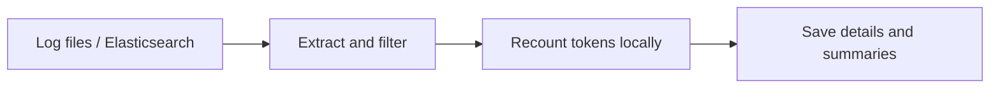

<p align="right"><a href="README.md">中文</a> | <strong>English</strong> | <a href="README.ja.md">日本語</a></p>

<h1 align="center">modulo</h1>
<p align="center"><strong>Recount AI gateway tokens. Trace every discrepancy to its source.</strong></p>
<p align="center">Python 3.12 · Local computation · Traceable source records · <a href="LICENSE">Apache-2.0</a></p>

<p align="center">
  <a href="#features">Features</a> ·
  <a href="#log-formats">Log formats</a> ·
  <a href="#tokenizers">Models</a> ·
  <a href="#quick-start">Quick start</a> ·
  <a href="#results">Results</a> ·
  <a href="#configuration">Configuration</a> ·
  <a href="#faq">FAQ</a>
</p>

modulo is an **AI token usage verification tool for existing logs**, built for teams managing aggregated AI gateways, MaaS operators, and auditors. Import logs, select providers and models, and compare reported usage with local reference counts while retaining a path back to each original record.



<a id="features"></a>

## Features

- **Compare usage**: summarize input token differences by provider and model; inspect separate local counts for answer and reasoning text.
- **Map internal model names**: assign multiple aliases to one tokenizer reference, with provider-specific mappings when needed.
- **Explain missing evidence**: distinguish consistent, deviating, and unverifiable results, keeping the reason for every unavailable calculation.
- **Trace the calculation**: retain source locations, field transformations, tokenizer/template revisions, and calculation parameters; verify result bundle integrity.

<a id="log-formats"></a>

## Supported log formats

Files and Elasticsearch use the same processing pipeline. Choose `adapter` according to the actual log format:

| Source and official reference | `adapter` | Accepted records | modulo examples |
| --- | --- | --- | --- |
| [Dify](https://docs.dify.ai/en/home) | `dify` | LLM node execution records, Agent thought exports, and explicitly supported per-call event formats | [Examples](examples/dify/README.md) |
| [LangChain](https://docs.langchain.com/oss/python/langchain/overview) | `langchain` | Run objects, including nested `child_runs` | [Examples](examples/langchain/README.md) |
| [New API](https://docs.newapi.pro/en) | `newapi` | Usage rows, supported DEBUG request/response records, and OpenAI-compatible SSE logs | [Examples](examples/newapi/README.md) |
| [One API](https://github.com/songquanpeng/one-api) | `oneapi` | Usage rows, supported request/response text, and paired exchange records | [Examples](examples/oneapi/README.md) |
| [LiteLLM logging specification](https://docs.litellm.ai/docs/proxy/logging_spec) | `litellm` | Final `StandardLoggingPayload` objects or individual `LiteLLM_SpendLogs` exports | [Examples](examples/litellm/README.md) |

Structured files use **JSONL: one record per line**. Expand JSON arrays into separate records first. New API and One API also accept supported DEBUG text. Usage tables typically contain usage without full bodies; missing fields remain explicit gaps. Usage rows require stable original row IDs, and request/response logs require explicit correlation IDs.

If the log object is wrapped in a field such as `payload`, set `payload-field: payload`. Streaming events in ES need explicit ordering, such as `event.sequence`; ES result order cannot establish stream order. Support depends on the actual fields and format, and does not imply that every system logs complete requests and responses by default.

<a id="tokenizers"></a>

## Supported tokenizers

The following **11 fixed model references support text recounting**, including reasoning and tool context already present in the logs. Model names link to official model information; use `asset` in mappings and tokenizer preparation commands.

<details>
<summary>Show fixed models, official sources, and asset names</summary>

| Family | Fixed model / official source | `asset` |
| --- | --- | --- |
| Qwen | [Qwen3.8-2.4T-A95B](https://huggingface.co/Qwen/Qwen3.8-2.4T-A95B) | `qwen3.8` |
| DeepSeek | [DeepSeek-V4.1-Flash](https://huggingface.co/deepseek-ai/DeepSeek-V4.1-Flash) | `deepseek-v4.1` |
| Moonshot / Kimi | [Kimi-K3](https://huggingface.co/moonshotai/Kimi-K3) | `kimi-k3` |
| MiniMax | [MiniMax-M3](https://huggingface.co/MiniMaxAI/MiniMax-M3) | `minimax-m3` |
| LongCat | [LongCat-2.0](https://huggingface.co/meituan-longcat/LongCat-2.0) | `longcat-2.0` |
| GLM | [GLM-5.3](https://huggingface.co/zai-org/GLM-5.3) | `glm-5.3` |
| Xiaomi MiMo | [MiMo-V2.6-Pro-RL](https://huggingface.co/XiaomiMiMo/MiMo-V2.6-Pro-RL) | `mimo-v2.6` |
| StepFun | [Step-3.7-Flash](https://huggingface.co/stepfun-ai/Step-3.7-Flash) | `step-3.7` |
| Tencent Hunyuan | [Hy4-preview](https://huggingface.co/tencent/Hy4-preview) | `hy4-preview` |
| Ant Ling | [Ling-3.0-flash](https://huggingface.co/inclusionAI/Ling-3.0-flash) | `ling-3.0` |
| Ant Ring | [Ring-2.6-1T](https://huggingface.co/inclusionAI/Ring-2.6-1T) | `ring-2.6` |

</details>

Each reference fixes its vocabulary, template, and parameters. Revisions and file hashes are recorded in the [asset manifest](src/modulo/application/assets-lock.json). Map internal aliases to the appropriate reference; other variants and cloud API aliases are not automatically treated as compatible. See [Hugging Face chat templates](https://huggingface.co/docs/transformers/chat_templating) for background on how templates affect input token counts.

<a id="quick-start"></a>

## Quick start

Requires [Python 3.12](https://docs.python.org/3.12/) and [uv](https://docs.astral.sh/uv/getting-started/installation/). Run these Bash commands from the repository root:

```bash
uv sync --locked
uv run modulo prepare-assets --only qwen3.8 deepseek-v4.1
uv run modulo import --config config/modulo.yaml
```

Asset preparation downloads tokenizer vocabularies, templates, and related files, without model weights. Recounting runs locally without a GPU or model API calls. For other models, replace the names after `--only` with assets from the table above; omit `--only` to prepare all assets.

The default configuration imports the bundled synthetic Dify sample: **8 calls, with 2 consistent, 1 deviating, and 5 unverifiable**. The sample deliberately includes discrepancies and missing fields.

Replace `RUN_DIR` below with the result directory printed after import:

```bash
uv run modulo report RUN_DIR            # Summary
uv run modulo report RUN_DIR --details  # Per-call details
uv run modulo verify RUN_DIR            # Bundle integrity
```

<a id="results"></a>

## Example results

This table presents selected actual results from the [Dify sample](examples/dify/basic.jsonl). The difference is **reported count − local reference count**:

| Model name in the log | Reported input tokens | Local input tokens | Difference | Verdict |
| --- | ---: | ---: | ---: | --- |
| Qwen/Qwen3.8-2.4T-A95B | 66 | 66 | 0 | Consistent `CONSISTENT` |
| deepseek-ai/DeepSeek-V4.1-Flash | 58 | 55 | +3 | Deviation `DEVIATION` |
| Qwen/Qwen3.8-2.4T-A95B | Not recorded | 59 | — | Unverifiable `UNVERIFIABLE` |

Verdicts describe **input comparison against a fixed tokenizer/template reference**. Answer and reasoning text are re-encoded and counted separately; these counts do not establish complete server-side output token usage. A match does not establish which model the provider actually deployed. Aggregate differences include only comparable calls, and missing values remain missing. See the [sample expectations](tests/fixtures/expected/basic.json).

Each import retains original records and locations, call details, differences, missing-data diagnostics, and calculation evidence. JSON/JSONL files preserve the evidence; DuckDB provides a rebuildable local query index. `verify` checks content hashes. New configurations or rules produce new results while preserving earlier results.

<a id="configuration"></a>

## Import your own logs

Configure three things: **where logs live, which tokenizer matches each internal model name, and which providers to scan**. Edit the [main configuration](config/modulo.yaml), then choose either the [file source](config/import-log-file.yaml) or [ES source](config/import-es.yaml). Source files contain reading settings only.

<details open>
<summary>Main configuration: log format, model aliases, and providers</summary>

Example `config/modulo.yaml`. Only two mappings are shown here; the repository configuration includes all 11 models:

```yaml
source: log
source-config: import-log-file.yaml
adapter: dify

# Enable provider filtering when needed
# platform-tag-source: field:platform
# platforms: [volcengine, huaweicloud]

models:
  - modelnames: [Qwen/Qwen3.8-2.4T-A95B, qwen-2.4t]
    asset: qwen3.8
  - modelnames: [deepseek-ai/DeepSeek-V4.1-Flash, volc-deepseek]
    asset: deepseek-v4.1

assets: ../assets/tokenizers
output: ../runs
```

Append internal aliases to the appropriate `modelnames` array. `models` defines mappings; use the CLI option `--models` to limit a scan to particular names. Unmapped models can still be imported, but cannot be recounted without a reference.

`platform-tag-source` supports `field:<path>`, `metadata:<path>`, `endpoint`, `literal:<provider>` and `none`. Omit `platforms` to scan all providers. For a batch from one known provider, use a literal such as `literal:volcengine`. Endpoint mode requires an explicit `endpoint-source` and `endpoint-map`; see the [example configuration](examples/dify/platforms-endpoint.yaml).

To restrict a mapping to one provider, add `platform` to that model entry; the entry can also specify `platform-tag-source`. A matching provider-specific entry takes precedence; otherwise the global entry without `platform` applies. Conflicting matches are errors. Provider and model names match exactly; `*` does not mean all.

</details>

<a id="file-source"></a>

<details>
<summary>File source: one file or date-based directory matching</summary>

`config/import-log-file.yaml`:

```yaml
path: /data/logs/dify
pattern: dify-access-log-202610*.jsonl
```

For one file, set `path` to that file and remove `pattern`. Directory imports require a pattern, with support for `*`, `?`, `[]`, and `**/`. Each import uses one adapter; import different formats separately.

</details>

<a id="es-source"></a>

<details>
<summary>Elasticsearch: index patterns and authentication</summary>

Set `source: es` and `source-config: import-es.yaml` in the main configuration. In `config/import-es.yaml`:

```yaml
path: https://es.example.com:9200
index: dify-access-log-202610*
username: audit-reader
password-env: MODULO_ES_PASSWORD
```

Provide the password through an environment variable, then import:

```bash
read -rsp 'ES password: ' MODULO_ES_PASSWORD
export MODULO_ES_PASSWORD
uv run modulo import --config config/modulo.yaml
```

For API key authentication, remove `username` and `password-env`, add `api-key-env: MODULO_ES_API_KEY`, and set that environment variable. Choose one authentication method. Unset or empty variables cause an error. Omitting authentication fields makes an unauthenticated connection, as used by the local lab.

For an ES query, add `query-file: query.json`. The file contains a query clause, for example `{"range":{"@timestamp":{"gte":"2026-10-01","lt":"2026-10-04"}}}`. Reading uses [PIT and search_after pagination](https://www.elastic.co/docs/reference/elasticsearch/rest-apis/paginate-search-results) without modifying source indices.

</details>

Paths in configuration files are relative to the YAML file declaring them; CLI paths are relative to the working directory. Explicit CLI arguments override their corresponding settings:

```bash
uv run modulo import --config config/modulo.yaml \
  --models "deepseek-ai/DeepSeek-V4.1-Flash" "volc-deepseek"
uv run modulo import --help
```

The default limit is 10,000 raw records per batch; adjust it with `--max-records`. Truncation, read errors, and data gaps are reflected in result statuses. Find more runnable inputs in the [protocol examples](examples/README.md).

<a id="faq"></a>

## FAQ

<details>
<summary>Why are some calls marked unverifiable?</summary>

The request body or reported usage may be missing, the model may lack a mapping, or the record may contain unsupported content. Details retain the reason and any available counts. Input and output are processed independently: missing input does not discard counts for available output text.

</details>

<details>
<summary>Can modulo recount tool calls and reasoning?</summary>

The fixed models above support reasoning and tool context recorded in logs, including input tool definitions, historical calls, and tool results. Answer and reasoning text are re-encoded separately. Verification of the complete generated tool-output token sequence is not implemented. Images, audio/video, unsupported parameters, and incomplete records produce explicit gaps.

</details>

<details>
<summary>How can I try local Elasticsearch and Kibana?</summary>

Requires Docker Engine and Compose; Kubernetes is unnecessary. From the repository root:

```bash
docker compose -f tests/local-dev/compose.yaml up -d --wait --wait-timeout 300
uv run python tests/local-dev/elastic_lab.py seed
uv run modulo import --source es --path http://localhost:9200 \
  --index 'dify-access-log-2026100*' --adapter dify --payload-field payload
```

Open [Kibana Discover](http://localhost:5601/s/modulo/app/discover) and select October 1–4, 2026 (Asia/Shanghai). Six daily indices contain 24 synthetic Dify and LangChain records. Kibana displays source logs; modulo displays recounting results.

The lab binds only to localhost and has no authentication; see the [Compose configuration](tests/local-dev/compose.yaml). An optional mirror override for access from China is available in [compose.mirror.yaml](tests/local-dev/compose.mirror.yaml); add its `-f` argument after the main file when starting Compose. Stop the containers with `docker compose -f tests/local-dev/compose.yaml stop`.

</details>

Feedback on log parsing, reproducible examples, and documentation improvements is welcome. Include the command, expected result, and a minimal example with sensitive information removed.

## License

modulo is licensed under the [Apache License 2.0](LICENSE). Third-party dependencies, tokenizers, and template assets retain their respective licenses.
