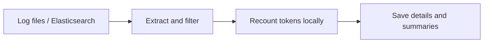

<p align="right"><a href="README.md">中文</a> | <strong>English</strong> | <a href="README.ja.md">日本語</a></p>

<h1 align="center">modulo</h1>
<p align="center"><strong>AI API buyers deserve their own “electricity meter”.</strong></p>
<p align="center">Recount tokens from existing logs and check the provider's reported usage.</p>
<p align="center">Python 3.12 · Local computation · Traceable source records · <a href="LICENSE">Apache-2.0</a></p>

<p align="center">
  <a href="#features">Features</a> ·
  <a href="#log-formats">Log formats</a> ·
  <a href="#tokenizers">Models</a> ·
  <a href="#quick-start">Quick start</a> ·
  <a href="#results">Results</a> ·
  <a href="#configuration">Configuration</a> ·
  <a href="#prometheus">Prometheus / Grafana</a> ·
  <a href="#faq">FAQ</a>
</p>

modulo is an **AI token usage verification tool for existing logs**, built for teams managing aggregated AI gateways, MaaS operators, and auditors. Import logs, select providers and models, and recount input and output tokens locally. Compare those counts with the provider-reported usage in the logs, with a path back to each original record.



<a id="features"></a>

## Features

- **Compare usage**: summarize input and output token differences by provider and model, including answer, reasoning, tool calls, and template control markers in the output reference.
- **Map internal model names**: assign multiple aliases to one tokenizer reference, with provider-specific mappings when needed.
- **Explain missing evidence**: distinguish consistent, deviating, and unverifiable results, keeping the reason for every unavailable calculation.
- **Trace the calculation**: retain source locations, field transformations, tokenizer/template revisions, and calculation parameters; verify result bundle integrity.
- **Export statistics**: write saved call counts, coverage and token differences directly to Prometheus, with an importable Grafana template.

<a id="log-formats"></a>

## Supported log formats

Files and Elasticsearch use the same processing pipeline. Choose `adapter` according to the actual log format:

| Source and official reference | `adapter` | Accepted records | modulo examples |
| --- | --- | --- | --- |
| [Dify](https://docs.dify.ai/en/home) | `dify` | LLM node execution records, Agent thought exports, and explicitly supported per-call event formats | [Examples](examples/dify/README.md) |
| [LangChain](https://docs.langchain.com/oss/python/langchain/overview) | `langchain` | Run objects, including nested `child_runs` and multiple input groups | [Examples](examples/langchain/README.md) |
| [New API](https://docs.newapi.pro/en) | `newapi` | Usage rows, supported DEBUG request/response records, and OpenAI-compatible SSE logs | [Examples](examples/newapi/README.md) |
| [One API](https://github.com/songquanpeng/one-api) | `oneapi` | Usage rows, supported request/response text, and paired exchange records | [Examples](examples/oneapi/README.md) |
| [LiteLLM logging specification](https://docs.litellm.ai/docs/proxy/logging_spec) | `litellm` | `StandardLoggingPayload`, `LiteLLM_SpendLogs`, and saved stream chunks | [Examples](examples/litellm/README.md) |

Structured files use **JSONL: one record per line**. Expand JSON arrays into separate records first. New API and One API also accept supported DEBUG text. Usage tables typically contain usage without full bodies; missing fields remain explicit gaps. Usage rows require stable original row IDs, and request/response logs require explicit correlation IDs.

If the log object is wrapped in a field such as `payload`, set `payload-field: payload`. Streaming events in ES need explicit ordering, such as `event.sequence`; ES result order cannot establish stream order. Support depends on the actual fields and format, and does not imply that every system logs complete requests and responses by default.

New API, One API, and LiteLLM adapters parse logged Chat Completions, [Responses](https://developers.openai.com/api/docs/guides/migrate-to-responses), and [Anthropic Messages](https://platform.claude.com/docs/en/api/messages/create) bodies: text, reasoning, function calls/results, and image inputs. All three adapters also assemble stream events already present in logs. [Runnable examples](examples/newapi/README.md#api-正文).

Structured `message` data in Dify thought exports can be recounted; empty fields remain missing. LangChain input groups are saved and counted separately; Run-level usage is compared once in `input_batches`, never allocated to individual groups. LiteLLM cache hits retain `cache_hit` and body recounts; cached usage is not compared as fresh inference usage. For missing New API/One API bodies, correlation IDs, retry identities or stream ordering, report `warnings` explain the impact, required fields and how to reimport.

<a id="tokenizers"></a>

## Supported tokenizers

The following **19 fixed model references** cover text, reasoning and tool context already present in the logs; ten visual models also support image input. Model names link to official model information; use `name` in mappings and tokenizer preparation commands.

<details>
<summary>Show fixed models, official sources, and canonical names</summary>

| Family | Fixed model / official source | `name` |
| --- | --- | --- |
| Qwen | [Qwen3.8-2.4T-A95B](https://huggingface.co/Qwen/Qwen3.8-2.4T-A95B) | `qwen-3.8-2.4t` |
| Qwen | [Qwen3.5-122B-A10B](https://huggingface.co/Qwen/Qwen3.5-122B-A10B) | `qwen3.5-122b` |
| Qwen | [Qwen3.5-397B-A17B](https://huggingface.co/Qwen/Qwen3.5-397B-A17B) | `qwen3.5-397b` |
| DeepSeek | [DeepSeek-V4.1-Flash](https://huggingface.co/deepseek-ai/DeepSeek-V4.1-Flash) | `deepseek-v4.1` |
| DeepSeek | [DeepSeek-V4-Pro-0813](https://huggingface.co/deepseek-ai/DeepSeek-V4-Pro-0813) | `deepseek-v4-pro-0813` |
| Moonshot / Kimi | [Kimi-K3](https://huggingface.co/moonshotai/Kimi-K3) | `kimi-k3` |
| Moonshot / Kimi | [Kimi-K2.6](https://huggingface.co/moonshotai/Kimi-K2.6) | `kimi-k2.6` |
| Moonshot / Kimi | [Kimi-K2.7-Code](https://huggingface.co/moonshotai/Kimi-K2.7-Code) | `kimi-k2.7-code` |
| MiniMax | [MiniMax-M3](https://huggingface.co/MiniMaxAI/MiniMax-M3) | `minimax-m3` |
| MiniMax | [MiniMax-M2.7](https://huggingface.co/MiniMaxAI/MiniMax-M2.7) | `minimax-m2.7` |
| LongCat | [LongCat-2.0](https://huggingface.co/meituan-longcat/LongCat-2.0) | `longcat-2.0` |
| GLM | [GLM-5.3](https://huggingface.co/zai-org/GLM-5.3) | `glm-5.3` |
| GLM | [GLM-5.3-Flash](https://huggingface.co/zai-org/GLM-5.3-Flash) | `glm-5.3-flash` |
| GLM | [GLM-5.2](https://huggingface.co/zai-org/GLM-5.2) | `glm-5.2` |
| Xiaomi MiMo | [MiMo-V2.6-Pro-RL](https://huggingface.co/XiaomiMiMo/MiMo-V2.6-Pro-RL) | `mimo-v2.6` |
| StepFun | [Step-3.7-Flash](https://huggingface.co/stepfun-ai/Step-3.7-Flash) | `step-3.7` |
| Tencent Hunyuan | [Hy4-preview](https://huggingface.co/tencent/Hy4-preview) | `hy4-preview` |
| Ant Ling | [Ling-3.0-flash](https://huggingface.co/inclusionAI/Ling-3.0-flash) | `ling-3.0` |
| Ant Ring | [Ring-2.6-1T](https://huggingface.co/inclusionAI/Ring-2.6-1T) | `ring-2.6` |

</details>

Each reference fixes its vocabulary, template, and parameters. Revisions and file hashes are recorded in the [tokenizer asset catalog](static/tokenizer-assets.json). Map internal aliases to the appropriate reference; other variants and cloud API aliases are not automatically treated as compatible. See [Hugging Face chat templates](https://huggingface.co/docs/transformers/chat_templating) for background on how templates affect input token counts.

The runtime catalog keeps fields needed for downloading, verification, and counting. [Image-processing sources](static/image-processing-sources.json) and [upstream license materials](licenses/README.md) are kept separately for review.

<a id="quick-start"></a>

## Quick start

Requires [Python 3.12](https://docs.python.org/3.12/) and [uv](https://docs.astral.sh/uv/getting-started/installation/). Run these Bash commands from the repository root:

```bash
uv sync --locked
uv run modulo prepare-assets --config config/modulo.yaml --only qwen-3.8-2.4t deepseek-v4.1
uv run modulo import --config config/modulo.yaml
```

Asset preparation downloads tokenizer vocabularies, templates, and related files, without model weights. Recounting runs locally without a GPU or model API calls. For other models, replace the names after `--only` with the `name` values from the table above; omit `--only` to prepare all assets.

Downloads default to `global` (Hugging Face). Set `asset-source: cn` in [modulo.yaml](config/modulo.yaml) to use [ModelScope](https://modelscope.cn/models), or override it with `prepare-assets --asset-source cn`. All 19 models have pinned ModelScope repositories and revisions. Both sources use the same file SHA-256 checks; verified local files are reused, and `cn` download failures never fall back to Global.

The default configuration imports the bundled synthetic Dify sample: **8 calls, with input verdicts of 2 consistent, 1 deviating, and 5 unverifiable**. The sample deliberately includes discrepancies and missing fields.

Replace `RUN_DIR` below with the result directory printed after import:

```bash
uv run modulo report RUN_DIR            # Summary
uv run modulo report RUN_DIR --details  # Per-call details
uv run modulo verify RUN_DIR            # Bundle integrity
```

<a id="results"></a>

## Example results

This table presents selected actual results from the [Dify sample](examples/dify/basic.jsonl). The difference is **reported count − local reference count**:

| Model name in the log | Reported input tokens | Local input tokens | Difference | Input verdict |
| --- | ---: | ---: | ---: | --- |
| Qwen/Qwen3.8-2.4T-A95B | 66 | 66 | 0 | Consistent `CONSISTENT` |
| deepseek-ai/DeepSeek-V4.1-Flash | 58 | 55 | +3 | Deviation `DEVIATION` |
| Qwen/Qwen3.8-2.4T-A95B | Not recorded | 59 | — | Unverifiable `UNVERIFIABLE` |

The table shows **input comparison against a fixed tokenizer/template reference**. Output has its own `output_tokens`, `output_delta`, and `output_verdict`, including reasoning, tool calls and termination markers, with the input generation prefix excluded. Both differences are reported usage minus the local reference; input and output verdicts are independent.

Results provide three verdicts; each summary field counts calls by verdict:

| Summary field | Detail field | Meaning |
| --- | --- | --- |
| `verdicts` | `verdict` | Overall call |
| `input_verdicts` | `input_verdict` | Input comparison |
| `output_verdicts` | `output_verdict` | Output comparison |

**Overall rule: either side deviates → deviation; both sides match → consistent; otherwise → unverifiable.** Opposite input and output differences cannot cancel into an overall match.

In the [output sample](examples/litellm/output-audit.jsonl), the complete reference for the same answer, reasoning and tool call is **45 tokens**: reported 45 matches, 48 differs by +3, and 42 by −3. Three more rows demonstrate missing usage, missing finish reason and truncation, all unverifiable. Run:

```bash
uv run modulo import --source log --adapter litellm \
  --path examples/litellm/output-audit.jsonl \
  --bindings examples/litellm/basic.bindings.yaml
```

This compares local references; it does not establish the original server-side token IDs or model identity. Component counts cannot simply be added to obtain the total. Summaries retain comparable-call counts, and missing values remain missing. See the [basic input expectations](tests/fixtures/expected/basic.json).

Each import retains original records and locations, call details, differences, missing-data diagnostics, and calculation evidence. JSON/JSONL files preserve the evidence; DuckDB provides a rebuildable local query index. `verify` checks content hashes. New configurations or rules produce new results while preserving earlier results.

<a id="configuration"></a>

## Import your own logs

Configure three things: **where logs live, which tokenizer matches each internal model name, and which providers to scan**. Edit the [main configuration](config/modulo.yaml), then choose either the [file source](config/import-log-file.yaml) or [ES source](config/import-es.yaml). Source files contain reading settings only.

<details open>
<summary>Main configuration: log format, model aliases, and providers</summary>

Example `config/modulo.yaml`. Only two mappings are shown here; the repository configuration includes all 19 models:

```yaml
source: log
source-config: import-log-file.yaml
adapter: dify

# Enable provider filtering when needed
# platform-tag-source: field:platform
# platforms: [volcengine, huaweicloud]

models:
  - name: qwen-3.8-2.4t
    aliases: [Qwen/Qwen3.8-2.4T-A95B, qwen-2.4t]
  - name: deepseek-v4.1
    aliases: [deepseek-ai/DeepSeek-V4.1-Flash, volc-deepseek]

assets: ../assets/tokenizers
output: ../runs
```

`name` selects the canonical model. List official names and internal aliases found in your logs in `aliases`; matching is exact. `models` defines mappings; use the CLI option `--models` to limit a scan to particular names. Unmapped models can still be imported, but cannot be recounted without a reference.

`platform-tag-source` supports `field:<path>`, `metadata:<path>`, `endpoint`, `literal:<provider>` and `none`. Omit `platforms` to scan all providers. For a batch from one known provider, use a literal such as `literal:volcengine`. Endpoint mode requires an explicit `endpoint-source` and `endpoint-map`; see the [example configuration](examples/dify/platforms-endpoint.yaml).

To restrict a mapping to one provider, add `platform` to that model entry; the entry can also specify `platform-tag-source`. A matching provider-specific entry takes precedence; otherwise the global entry without `platform` applies. Conflicting matches are errors. Provider and model names match exactly; `*` does not mean all.

</details>

<a id="file-source"></a>

<details>
<summary>File source: one file or date-based directory matching</summary>

`config/import-log-file.yaml`:

```yaml
path: /data/logs/dify
pattern: dify-access-log-202610*.jsonl
```

For one file, set `path` to that file and remove `pattern`. Directory imports require a pattern, with support for `*`, `?`, `[]`, and `**/`. Each import uses one adapter; import different formats separately.

</details>

<a id="es-source"></a>

<details>
<summary>Elasticsearch: index patterns and authentication</summary>

Set `source: es` and `source-config: import-es.yaml` in the main configuration. In `config/import-es.yaml`:

```yaml
path: https://es.example.com:9200
index: dify-access-log-202610*
username: audit-reader
password-env: MODULO_ES_PASSWORD
```

Provide the password through an environment variable, then import:

```bash
read -rsp 'ES password: ' MODULO_ES_PASSWORD
export MODULO_ES_PASSWORD
uv run modulo import --config config/modulo.yaml
```

For API key authentication, remove `username` and `password-env`, add `api-key-env: MODULO_ES_API_KEY`, and set that environment variable. Choose one authentication method. Unset or empty variables cause an error. Omitting authentication fields makes an unauthenticated connection, as used by the local lab.

For an ES query, add `query-file: query.json`. The file contains a query clause, for example `{"range":{"@timestamp":{"gte":"2026-10-01","lt":"2026-10-04"}}}`. Reading uses [PIT and search_after pagination](https://www.elastic.co/docs/reference/elasticsearch/rest-apis/paginate-search-results) without modifying source indices.

</details>

Paths in configuration files are relative to the YAML file declaring them; CLI paths are relative to the working directory. Explicit CLI arguments override their corresponding settings:

```bash
uv run modulo import --config config/modulo.yaml \
  --models "deepseek-ai/DeepSeek-V4.1-Flash" "volc-deepseek"
uv run modulo import --help
```

Imports have no record-count limit by default. Intermediate records, identity checks and pending event groups use a local disk workspace; calculations and output are processed row by row. `--memory-mib 64` sets the working-cache budget, not a total process memory cap: tokenizers, individual calls and JSON decoding require additional memory. `--max-record-mib` defaults to 8; `--max-records N` limits newly read records per import, with 0 meaning unlimited.

Use a state directory to resume reading and join requests/responses arriving in separate imports. Add `--follow` for repeated reading:

```bash
uv run modulo import --config config/modulo.yaml --state runs/import-state
uv run modulo import --config config/modulo.yaml --state runs/import-state \
  --follow --poll-seconds 30
```

Each state directory produces cumulative snapshots, retains earlier results and reuses unchanged calculations. After Ctrl+C, rerun the same command; uncommitted reads are replayed and deduplicated. File appends and rename rotation are supported; incomplete lines wait for a newline, while altered or truncated consumed prefixes raise an error. ES resumes a valid snapshot cursor; expired snapshots and new scans reread pages and deduplicate source records, including previously read documents. State and historical snapshots consume disk space; use separate directories for audit periods and new state directories when calculation rules or code change. Incomplete reads and data gaps remain visible in reports. See the [protocol examples](examples/README.md) for runnable inputs.

<a id="sampling"></a>

## Sampling and buyer data boundaries

Full processing is the default. Set `sampling` in the main configuration:

| mode | Behavior | Required parameters |
| --- | --- | --- |
| `all` | Recount all calls matching the filters | None |
| `ratio` | Sample each platform/model with a fixed inclusion probability; actual counts vary | `ratio: 0.1` |
| `count` | Randomly select up to N units per platform/model | `count: 100` |
| `window` | Randomly select up to N units from one completed time window | `window-minutes: 5`, `count: 100` |

```yaml
sampling:
  mode: window
  window-minutes: 5
  count: 100
  seed: buyer-local-seed
```

Window sampling uses the normalized call's `started_at`. The default is the latest completed UTC window, inclusive at the start and exclusive at the end: running at 10:07 with a five-minute window selects 10:00–10:05. Replay a historical window with `--sample-before '2026-10-13T10:05:00+08:00'`. Missing, timezone-free or conflicting timestamps remain local diagnostics.

Requests, responses and stream fragments are assembled before sampling. A normal call is one unit; a LangChain Run sharing aggregate usage is sampled as a whole unit, so call counts may exceed the quota. The same logs and `seed` reproduce the sample regardless of read order. `max-records` is a reading cap, not random sampling. Sampling saves recount work; selected source logs still need to be read and assembled.

CLI options override configuration. Switching modes clears the previous mode's probability, quota and window parameters:

```bash
uv run modulo import --config config/modulo.yaml --sample-mode ratio --sample-ratio 0.1
uv run modulo import --config config/modulo.yaml --sample-mode count --sample-count 100
```

Use system [cron](https://man7.org/linux/man-pages/man5/crontab.5.html) for scheduling; each invocation exits after processing. This example runs every five minutes after window mode is configured; replace `/opt/modulo` with your installation path:

```cron
*/5 * * * * /opt/modulo/.venv/bin/modulo import --config /opt/modulo/config/modulo.yaml --state /opt/modulo/state >> /opt/modulo/sampling.log 2>&1
```

Trigger frequency and window length are separate settings. Only the latest completed window is selected automatically; missed windows and late logs can be replayed with `--sample-before`. This command neither uploads results nor installs a scheduled task.

For an external Prometheus receiver, set `visibility: sample-only` in the export configuration. Only filled `count`/`window` sample statistics are sent: no raw record count, population, actual sampling fraction, seed or population coverage. `auto` uses this policy for window mode and full export otherwise. `full` is for buyer-internal receivers authorized to see population size. Full and proportional samples cannot use sample-only.

Underfilled quotas, incomplete reading, invalid records or unresolved call times return `export: withheld` without sending a request. Exit code 0 means the policy completed, not that data was sent. The receiver retains its previous snapshot; check its age. Changing visibility does not erase already exported history; use a separate external scope/receiver.

Local bundles, command output and the cron log still contain full population information and raw evidence; they are not restricted exports. Sample coverage divides by sampled calls. Population coverage divides by eligible calls within the sampling scope and is available only locally or through full export. Counts are retained explicitly; unresolved times remain separate.

<a id="prometheus"></a>

## Prometheus and Grafana

Start your Prometheus server with `--web.enable-remote-write-receiver`, then export an existing result bundle:

```bash
uv run modulo export-prometheus runs/<result-directory> \
  --url http://localhost:9090/api/v1/write --scope my-gateway

# Alternatively, store the destination, scope and authentication settings in YAML
uv run modulo export-prometheus runs/<result-directory> \
  --config config/export-prometheus.yaml
```

The [export configuration](config/export-prometheus.yaml) supports Basic or Bearer authentication through named environment variables, a custom CA file, timeout and series limit. Explicit CLI options take precedence. The command verifies the bundle, reads saved calculations, sends metrics and exits; it does not rerun tokenizers or require Pushgateway or a resident service. Users enable the [Remote Write receiver](https://prometheus.io/docs/prometheus/latest/querying/api/#remote-write-receiver) on their own Prometheus server.

[Import](https://grafana.com/docs/grafana/latest/visualizations/dashboards/build-dashboards/import-dashboards/) [static/grafana/modulo.json](static/grafana/modulo.json) into Grafana and select your Prometheus data source. The template (Chinese panel labels) shows calls, overall/input/output verdicts, recount and comparison coverage, and token differences by scope, provider and model. A zero denominator means no data. Token comparisons use the same comparable call cohort. LangChain Run-level usage groups remain separate.

Use a stable `scope` for each statistical scope. The latest exported snapshot is shown; exporting again does not add to call counts. Independent gateways or audit scopes need different scope names. All metrics are Gauges: do not use `rate()` or `increase()` to derive call volume. The template excludes model groups absent from the latest snapshot and displays the original result time separately; re-exporting an old bundle does not change that time. Samples use the **export time**, not the log event time; this is not historical event-time backfill.

The template displays the last export within the selected time range (7 days by default). Data outside that range or Prometheus retention is unavailable. Details and exact integers remain in the local bundle. Network errors, HTTP 429 and 5xx receive at most 3 attempts; other failures stop immediately with a nonzero exit code. The default limit is 10,000 metric series per export, adjustable with `--max-series`. Users deploy and maintain Prometheus and Grafana.

<a id="faq"></a>

## FAQ

<details>
<summary>Why are some calls marked unverifiable?</summary>

The request body or reported usage may be missing, the model may lack a mapping, or the record may contain unsupported content. Details retain the reason and any available counts. Input and output are processed independently: missing input does not discard counts for available output text.

</details>

<details>
<summary>Can modulo recount tool calls and reasoning?</summary>

All 19 fixed models support input tool context and complete output references, including reasoning, parallel tool calls, control and termination markers. Normal endings include template termination markers. Token limits (`length` / `max_tokens`) count the generated content without inventing an EOS. Logged matching stop strings or token IDs are counted once; missing stop evidence produces a specific gap. Reported usage is required for a difference and verdict. Actual log truncation, missing fields, audio/video and unknown parameters retain explicit gaps; `partial` does not mean fully verified.

Request support includes `response_format` / JSON Schema, `tool_choice` (including named functions), `parallel_tool_calls`, and generation-prefix options. Constraints are passed to the selected template without inventing prompt text. Multiple assistant messages in Responses retain their boundaries. Bindings accept `chat-template` / `template-kwargs` for configured references, including ordered interleaved content. See [parameter and template configuration](examples/litellm/README.md#请求参数与自定义模板).

Structured content blocks such as `thinking` and `reasoning` are supported, with original blocks and field sources retained. Signatures are excluded from text counts; summaries or redacted content do not substitute for complete reasoning. Multiple candidates from LangChain, LiteLLM, New API and One API are counted separately and compared with request-level usage once. See the [runnable example](examples/litellm/README.md#结构化正文与多候选).

</details>

<details>
<summary>Can modulo recount image input?</summary>

Fixed image references are available for Qwen3.5-122B-A10B/397B-A17B, DeepSeek-V4.1-Flash, Kimi-K3/K2.6/K2.7-Code, GLM-5.3-Flash, MiniMax-M3, MiMo-V2.6-Pro-RL and Step-3.7-Flash. Visual positions, image boundaries and crop markers are combined with text into the complete input count. No model weights or GPU are required.

Logs must preserve image order and either embedded images or reliable dimensions. Qwen3.5, GLM-5.3-Flash, MiniMax-M3 and MiMo also accept a per-image `image_grid_thw`. Missing processing settings are labelled fixed reference defaults. All five log adapters share this capability; see the [image example and results](examples/litellm/README.md#图片输入).

For URL images without dimensions, enable downloading in the main configuration. It is **off by default**. When enabled, modulo downloads public HTTP(S) images, reads their dimensions and recounts the input:

```yaml
image-download:
  enabled: true
  cache-dir: /tmp/modulo-images  # Optional; defaults to a dedicated system temp directory
  max-file-bytes: 10485760      # 10 MiB per image
  max-cache-bytes: 268435456    # 256 MiB total cache
  ttl-seconds: 86400           # Keep for 24 hours
```

`--download-images` / `--no-download-images` override the switch. Imports with downloading enabled remove expired and excess cache files at startup, exit and after cache writes. No background service runs, and the cache is not a permanent archive. Relative cache paths resolve from the main configuration file.

Details retain retrieval time, SHA-256, byte size and provenance. Broken links, size limits, truncated images, missing order and unsupported crop or `detail` settings produce explicit gaps; output recounting remains independent. Local file paths are not accessed, and system proxies or login credentials are not inherited.

Private addresses are blocked by default. For an internal image server or DNS Fake-IP mapping, add `allow-private-hosts: [images.example.com]` under `image-download` to trust an exact hostname. Wildcards are rejected, and redirect destinations are checked separately.

</details>

<details>
<summary>How can I try local Elasticsearch and Kibana?</summary>

Requires Docker Engine and Compose; Kubernetes is unnecessary. From the repository root:

```bash
docker compose -f tests/local-dev/compose.yaml up -d --wait --wait-timeout 300
uv run python tests/local-dev/elastic_lab.py seed
uv run modulo import --source es --path http://localhost:9200 \
  --index 'dify-access-log-2026100*' --adapter dify --payload-field payload
```

Open [Kibana Discover](http://localhost:5601/s/modulo/app/discover) and select October 1–4, 2026 (Asia/Shanghai). Six daily indices contain 24 synthetic Dify and LangChain records. Kibana displays source logs; modulo displays recounting results.

The lab binds only to localhost and has no authentication; see the [Compose configuration](tests/local-dev/compose.yaml). An optional mirror override for access from China is available in [compose.mirror.yaml](tests/local-dev/compose.mirror.yaml); add its `-f` argument after the main file when starting Compose. Stop the containers with `docker compose -f tests/local-dev/compose.yaml stop`.

</details>

Feedback on log parsing, reproducible examples, and documentation improvements is welcome. Include the command, expected result, and a minimal example with sensitive information removed.

## License

modulo is licensed under the [Apache License 2.0](LICENSE). Third-party dependencies, tokenizers, and template assets retain their respective licenses; preserved upstream license texts are in [licenses/](licenses/README.md).
