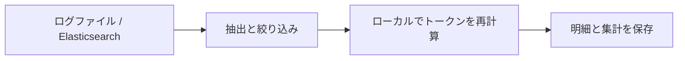

<p align="right"><a href="README.md">中文</a> | <a href="README.en.md">English</a> | <strong>日本語</strong></p>

<h1 align="center">modulo</h1>
<p align="center"><strong>AI ゲートウェイのトークン使用量を再計算し、差分を元のログまで追跡。</strong></p>
<p align="center">Python 3.12 · ローカル計算 · 元の記録を保持 · <a href="LICENSE">Apache-2.0</a></p>

<p align="center">
  <a href="#features">機能</a> ·
  <a href="#log-formats">ログ形式</a> ·
  <a href="#tokenizers">対応モデル</a> ·
  <a href="#quick-start">クイックスタート</a> ·
  <a href="#results">結果の例</a> ·
  <a href="#configuration">設定</a> ·
  <a href="#faq">よくある質問</a>
</p>

modulo は、**既存のログから AI のトークン使用量を検証するツール**です。複数の AI サービスを集約するゲートウェイの管理・運用担当者、MaaS 事業者、監査担当者を対象としています。ログを読み込み、プロバイダーとモデルを選ぶと、報告された使用量、ローカルでの再計算値、差分を確認できます。各結果から元の記録を追跡できます。



<a id="features"></a>

## 機能

- **使用量の照合**：プロバイダー・モデル別に入力トークンの差分を集計し、回答本文と推論本文のローカル計数値を個別に確認できます。
- **社内モデル名の対応付け**：複数の別名を同じ tokenizer の参照に割り当て、必要に応じてプロバイダー別に設定できます。
- **不足情報の明示**：一致、差分あり、検証不可を区別し、再計算できない理由を保持します。
- **計算根拠の追跡**：元のログ位置、フィールド変換、tokenizer・テンプレートのリビジョン、計算パラメーターを保存し、結果ファイルの整合性を検証できます。

<a id="log-formats"></a>

## 対応するログ形式

ファイルと Elasticsearch は同じ処理フローを使用します。実際のログ形式に合わせて `adapter` を選択してください。

| ログの生成元と公式資料 | `adapter` | 読み込める記録 | modulo のサンプル |
| --- | --- | --- | --- |
| [Dify](https://docs.dify.ai/en/home) | `dify` | LLM ノードの実行記録、Agent thought のエクスポート、明示的に対応した呼び出し単位のイベント形式 | [サンプル](examples/dify/README.md) |
| [LangChain](https://docs.langchain.com/oss/python/langchain/overview) | `langchain` | ネストされた `child_runs` を含む Run オブジェクト | [サンプル](examples/langchain/README.md) |
| [New API](https://docs.newapi.pro/en) | `newapi` | 使用量レコード、対応済みの DEBUG リクエスト・レスポンス記録、OpenAI 互換 SSE ログ | [サンプル](examples/newapi/README.md) |
| [One API](https://github.com/songquanpeng/one-api) | `oneapi` | 使用量レコード、対応済みのリクエスト・レスポンステキスト、対応付け済みの記録 | [サンプル](examples/oneapi/README.md) |
| [LiteLLM ログ仕様](https://docs.litellm.ai/docs/proxy/logging_spec) | `litellm` | 完了時の `StandardLoggingPayload` または単一の `LiteLLM_SpendLogs` エクスポート | [サンプル](examples/litellm/README.md) |

構造化ファイルは **JSONL（1 行に 1 レコード）**を使用します。JSON 配列は事前にレコード単位へ展開してください。New API／One API は対応済みの DEBUG テキストも読み込めます。使用量テーブルに本文がない場合は、その不足を記録します。使用量レコードには安定した元の行 ID、リクエスト・レスポンスログには明示的な関連付け ID が必要です。

ログ本体が `payload` などのフィールド内にある場合は、`payload-field: payload` を設定します。ES 内のストリーミングイベントには `event.sequence` などの明示的な順序情報が必要です。ES の返却順からストリームの順序を推測しません。対応範囲は実際のフィールドと形式によって決まり、各システムの標準ログに完全なリクエスト・レスポンスが含まれることを意味しません。

<a id="tokenizers"></a>

## 対応する tokenizer

以下の **11 モデルを固定したテキスト再計算用の参照**として使用できます。ログに記録された推論とツールのコンテキストにも対応しています。モデル名のリンク先は公式資料です。設定と tokenizer の準備には `asset` 名を使用します。

<details>
<summary>モデル、公式資料、asset 名を表示</summary>

| ファミリー | 固定モデル／公式資料 | `asset` |
| --- | --- | --- |
| Qwen | [Qwen3.8-2.4T-A95B](https://huggingface.co/Qwen/Qwen3.8-2.4T-A95B) | `qwen3.8` |
| DeepSeek | [DeepSeek-V4.1-Flash](https://huggingface.co/deepseek-ai/DeepSeek-V4.1-Flash) | `deepseek-v4.1` |
| Moonshot / Kimi | [Kimi-K3](https://huggingface.co/moonshotai/Kimi-K3) | `kimi-k3` |
| MiniMax | [MiniMax-M3](https://huggingface.co/MiniMaxAI/MiniMax-M3) | `minimax-m3` |
| LongCat | [LongCat-2.0](https://huggingface.co/meituan-longcat/LongCat-2.0) | `longcat-2.0` |
| GLM | [GLM-5.3](https://huggingface.co/zai-org/GLM-5.3) | `glm-5.3` |
| Xiaomi MiMo | [MiMo-V2.6-Pro-RL](https://huggingface.co/XiaomiMiMo/MiMo-V2.6-Pro-RL) | `mimo-v2.6` |
| StepFun | [Step-3.7-Flash](https://huggingface.co/stepfun-ai/Step-3.7-Flash) | `step-3.7` |
| Tencent Hunyuan | [Hy4-preview](https://huggingface.co/tencent/Hy4-preview) | `hy4-preview` |
| Ant Ling | [Ling-3.0-flash](https://huggingface.co/inclusionAI/Ling-3.0-flash) | `ling-3.0` |
| Ant Ring | [Ring-2.6-1T](https://huggingface.co/inclusionAI/Ring-2.6-1T) | `ring-2.6` |

</details>

参照ごとに語彙、テンプレート、パラメーターを固定し、リビジョンとファイルハッシュを [アセット一覧](src/modulo/application/assets-lock.json) に記録しています。社内の別名には適切な参照を割り当ててください。同じファミリーの別モデルやクラウド API の別名を、自動的に互換と見なしません。テンプレートが入力トークン数に与える影響は [Hugging Face のチャットテンプレート説明](https://huggingface.co/docs/transformers/chat_templating) を参照してください。

<a id="quick-start"></a>

## クイックスタート

[Python 3.12](https://docs.python.org/3.12/) と [uv](https://docs.astral.sh/uv/getting-started/installation/) が必要です。以下の Bash コマンドをリポジトリのルートで実行します。

```bash
uv sync --locked
uv run modulo prepare-assets --only qwen3.8 deepseek-v4.1
uv run modulo import --config config/modulo.yaml
```

アセットの準備では tokenizer の語彙やテンプレートなどをダウンロードし、モデルの重みはダウンロードしません。再計算はローカルで実行され、GPU やモデル API の呼び出しは不要です。別のモデルを使う場合は `--only` の後を上表の asset 名に置き換えます。`--only` を省略すると全アセットを準備します。

標準設定では同梱の Dify 合成サンプルを読み込み、**8 件の呼び出し：一致 2 件、差分あり 1 件、検証不可 5 件**を出力します。サンプルには差分やフィールド不足のケースを意図的に含めています。

以下の `RUN_DIR` を、インポート後に表示される結果ディレクトリに置き換えてください。

```bash
uv run modulo report RUN_DIR            # 集計
uv run modulo report RUN_DIR --details  # 呼び出しごとの明細
uv run modulo verify RUN_DIR            # 結果ファイルの整合性
```

<a id="results"></a>

## 結果の例

[Dify サンプル](examples/dify/basic.jsonl) の実際の結果の一部を表にしたものです。差分は **ログの報告値 − ローカル参照値**です。

| ログ内のモデル名 | 報告された入力トークン数 | ローカル入力トークン数 | 差分 | 判定 |
| --- | ---: | ---: | ---: | --- |
| Qwen/Qwen3.8-2.4T-A95B | 66 | 66 | 0 | 一致 `CONSISTENT` |
| deepseek-ai/DeepSeek-V4.1-Flash | 58 | 55 | +3 | 差分あり `DEVIATION` |
| Qwen/Qwen3.8-2.4T-A95B | 記録なし | 59 | — | 検証不可 `UNVERIFIABLE` |

判定は、**固定した tokenizer・テンプレートによる入力参照値との比較**です。回答本文と推論本文はそれぞれ再エンコードして計数しますが、サーバー側の出力トークン使用量全体を確定するものではありません。一致しても、プロバイダーが実際に使用したモデルの識別を証明することにはなりません。差分の集計は比較可能な呼び出しのみを対象とし、欠損値をゼロで埋めません。期待値は [サンプルの記録](tests/fixtures/expected/basic.json) にあります。

インポートごとに元の記録と位置、呼び出し明細、差分、不足情報、計算根拠を保存します。JSON／JSONL が検証用の記録を保持し、DuckDB が再構築可能なローカル検索を提供します。`verify` は内容のハッシュを検証します。設定やルールを変更すると新しい結果を生成し、以前の結果は保持します。

<a id="configuration"></a>

## 自分のログを読み込む

主に設定するのは **ログの場所、社内モデル名と tokenizer の対応、対象プロバイダー**の 3 点です。[メイン設定](config/modulo.yaml) を編集し、[ファイル用](config/import-log-file.yaml) または [ES 用](config/import-es.yaml) の入力元設定を選択します。入力元の設定には読み取りに関する項目だけを記述します。

<details open>
<summary>メイン設定：ログ形式、モデルの別名、プロバイダー</summary>

`config/modulo.yaml` の例です。ここでは 2 モデルのみを示していますが、リポジトリ内の設定には 11 モデルすべてが含まれています。

```yaml
source: log
source-config: import-log-file.yaml
adapter: dify

# 必要に応じてプロバイダーを絞り込む
# platform-tag-source: field:platform
# platforms: [volcengine, huaweicloud]

models:
  - modelnames: [Qwen/Qwen3.8-2.4T-A95B, qwen-2.4t]
    asset: qwen3.8
  - modelnames: [deepseek-ai/DeepSeek-V4.1-Flash, volc-deepseek]
    asset: deepseek-v4.1

assets: ../assets/tokenizers
output: ../runs
```

社内の別名は、対応する `modelnames` 配列に追加します。`models` は対応付けの設定です。特定のモデルだけを処理するには CLI の `--models` を使います。未登録モデルも読み込めますが、参照がなければ再計算できません。

`platform-tag-source` は `field:<パス>`、`metadata:<パス>`、`endpoint`、`literal:<プロバイダー名>`、`none` に対応しています。全プロバイダーを対象にする場合は `platforms` を省略します。バッチ全体が単一プロバイダーの場合は `literal:volcengine` などを指定できます。endpoint モードでは `endpoint-source` と `endpoint-map` による明示的な対応付けが必要です。[設定例](examples/dify/platforms-endpoint.yaml) を参照してください。

モデルの対応付けを特定プロバイダーに限定する場合、その項目に `platform` を追加します。項目内に `platform-tag-source` を指定することもできます。条件に一致するプロバイダー別の項目が優先され、それ以外は `platform` のない共通項目を使います。矛盾する複数の一致はエラーになります。プロバイダー名とモデル名は完全一致で照合し、`*` は全件を意味しません。

</details>

<a id="file-source"></a>

<details>
<summary>ファイル入力：単一ファイルまたは日付パターンによる検索</summary>

`config/import-log-file.yaml`：

```yaml
path: /data/logs/dify
pattern: dify-access-log-202610*.jsonl
```

単一ファイルの場合は `path` にファイルを指定し、`pattern` を削除します。ディレクトリの読み込みには pattern が必須で、`*`、`?`、`[]`、`**/` を使用できます。1 回のインポートで使用する adapter は 1 つです。異なる形式は別々に処理してください。

</details>

<a id="es-source"></a>

<details>
<summary>Elasticsearch：インデックスパターンと認証</summary>

メイン設定を `source: es`、`source-config: import-es.yaml` に変更します。`config/import-es.yaml`：

```yaml
path: https://es.example.com:9200
index: dify-access-log-202610*
username: audit-reader
password-env: MODULO_ES_PASSWORD
```

環境変数でパスワードを渡してからインポートします。

```bash
read -rsp 'ES password: ' MODULO_ES_PASSWORD
export MODULO_ES_PASSWORD
uv run modulo import --config config/modulo.yaml
```

API キー認証を使う場合は `username` と `password-env` を削除し、`api-key-env: MODULO_ES_API_KEY` を追加して対応する環境変数を設定します。認証方法はどちらか一方を選択します。指定した変数が未設定または空の場合はエラーになります。認証項目を省略すると、ローカル実験環境と同様に認証なしで接続します。

ES の検索条件を指定する場合は `query-file: query.json` を追加します。ファイルには `{"range":{"@timestamp":{"gte":"2026-10-01","lt":"2026-10-04"}}}` のようなクエリ句を記述します。[PIT と search_after によるページング](https://www.elastic.co/docs/reference/elasticsearch/rest-apis/paginate-search-results) で読み取り、元のインデックスは変更しません。

</details>

設定内の相対パスは、それを記述した YAML ファイルのディレクトリが基準です。CLI のパスは作業ディレクトリが基準です。明示的な CLI 引数は対応する設定値を上書きします。

```bash
uv run modulo import --config config/modulo.yaml \
  --models "deepseek-ai/DeepSeek-V4.1-Flash" "volc-deepseek"
uv run modulo import --help
```

標準では 1 バッチにつき元のレコードを最大 10,000 件読み込みます。`--max-records` で変更できます。読み取りの打ち切り、読み取りエラー、データ不足は結果の状態に反映されます。ほかの実行可能な入力例は [プロトコル別サンプル](examples/README.md) を参照してください。

<a id="faq"></a>

## よくある質問

<details>
<summary>「検証不可」になる呼び出しがあるのはなぜですか？</summary>

リクエスト本文や報告された usage がない、モデルが対応付けられていない、未対応の内容が含まれる、といった理由が考えられます。明細には理由と取得できた計数値を保持します。入力と出力は独立して処理するため、入力が欠けていても取得済みの出力本文の計数値は失われません。

</details>

<details>
<summary>ツール呼び出しや推論内容も再計算できますか？</summary>

上記の固定モデルについて、ログ内の推論・ツールコンテキストに対応しています。入力中のツール定義、過去の呼び出し、ツール結果も含みます。回答本文と推論本文は個別に再エンコードして計数します。ツール呼び出し出力の生成トークン列全体の検証は未実装です。画像、音声・動画、未対応パラメーター、不完全な記録は、それぞれ不足や制限として記録します。

</details>

<details>
<summary>ローカルで Elasticsearch と Kibana を試すには？</summary>

Docker Engine と Compose が必要です。Kubernetes は不要です。リポジトリのルートで実行します。

```bash
docker compose -f tests/local-dev/compose.yaml up -d --wait --wait-timeout 300
uv run python tests/local-dev/elastic_lab.py seed
uv run modulo import --source es --path http://localhost:9200 \
  --index 'dify-access-log-2026100*' --adapter dify --payload-field payload
```

[Kibana Discover](http://localhost:5601/s/modulo/app/discover) を開き、期間を 2026 年 10 月 1 日から 4 日（Asia/Shanghai）に設定します。6 つの日次インデックスに、Dify と LangChain の合成ログが合計 24 件あります。Kibana では元のログ、modulo では再計算結果を確認します。

実験用サービスは localhost のみで待ち受け、認証はありません。[Compose 設定](tests/local-dev/compose.yaml) を参照してください。中国からのアクセス向けには [compose.mirror.yaml](tests/local-dev/compose.mirror.yaml) を利用できます。起動時にメインファイルの後へ、このファイルを指定する `-f` 引数を追加します。停止する場合は `docker compose -f tests/local-dev/compose.yaml stop` を実行します。

</details>

ログ解析に関する報告、再現可能なサンプル、説明の改善を歓迎します。実行コマンド、期待する結果、機密情報を除いた最小限のサンプルを添えてください。

## ライセンス

modulo は [Apache License 2.0](LICENSE) で公開されています。サードパーティーの依存ライブラリ、tokenizer、テンプレートのアセットには、それぞれのライセンスが適用されます。
