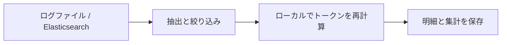

<p align="right"><a href="README.md">中文</a> | <a href="README.en.md">English</a> | <strong>日本語</strong></p>

<h1 align="center">modulo</h1>
<p align="center"><strong>AI API を買うなら、自分の「電力メーター」も。</strong></p>
<p align="center">既存のログからトークンを再計算し、プロバイダーが報告した使用量と照合します。</p>
<p align="center">Python 3.12 · ローカル計算 · 元の記録を保持 · <a href="LICENSE">Apache-2.0</a></p>

<p align="center">
  <a href="#features">機能</a> ·
  <a href="#log-formats">ログ形式</a> ·
  <a href="#tokenizers">対応モデル</a> ·
  <a href="#quick-start">クイックスタート</a> ·
  <a href="#results">結果の例</a> ·
  <a href="#configuration">設定</a> ·
  <a href="#prometheus">Prometheus / Grafana</a> ·
  <a href="#faq">よくある質問</a>
</p>

modulo は、**既存のログから AI のトークン使用量を検証するツール**です。複数の AI サービスを集約するゲートウェイの管理・運用担当者、MaaS 事業者、監査担当者を対象としています。ログを読み込み、プロバイダーとモデルを選ぶと、入力・出力トークンをローカルで再計算し、ログに記録されたプロバイダーの報告値と比較できます。各結果から元の記録を追跡できます。



<a id="features"></a>

## 機能

- **使用量の比較**：プロバイダー・モデルごとに入力と出力の差分を集計します。出力参照には回答、推論、ツール呼び出し、制御マーカーを含みます。
- **社内モデル名の対応付け**：複数の別名を同じ tokenizer の参照に割り当て、必要に応じてプロバイダー別に設定できます。
- **不足情報の明示**：一致、差分あり、検証不可を区別し、再計算できない理由を保持します。
- **計算根拠の追跡**：元のログ位置、フィールド変換、tokenizer・テンプレートのリビジョン、計算パラメーターを保存し、結果ファイルの整合性を検証できます。

- **統計のエクスポート**：保存済みの呼び出し数・カバレッジ・差分を Prometheus に直接送信し、Grafana テンプレートで表示できます。

<a id="log-formats"></a>

## 対応するログ形式

ファイルと Elasticsearch は同じ処理フローを使用します。実際のログ形式に合わせて `adapter` を選択してください。

| ログの生成元と公式資料 | `adapter` | 読み込める記録 | modulo のサンプル |
| --- | --- | --- | --- |
| [Dify](https://docs.dify.ai/en/home) | `dify` | LLM ノードの実行記録、Agent thought のエクスポート、明示的に対応した呼び出し単位のイベント形式 | [サンプル](examples/dify/README.md) |
| [LangChain](https://docs.langchain.com/oss/python/langchain/overview) | `langchain` | ネストされた `child_runs` と複数入力グループを含む Run オブジェクト | [サンプル](examples/langchain/README.md) |
| [New API](https://docs.newapi.pro/en) | `newapi` | 使用量レコード、対応済みの DEBUG リクエスト・レスポンス記録、OpenAI 互換 SSE ログ | [サンプル](examples/newapi/README.md) |
| [One API](https://github.com/songquanpeng/one-api) | `oneapi` | 使用量レコード、対応済みのリクエスト・レスポンステキスト、対応付け済みの記録 | [サンプル](examples/oneapi/README.md) |
| [LiteLLM ログ仕様](https://docs.litellm.ai/docs/proxy/logging_spec) | `litellm` | `StandardLoggingPayload`、`LiteLLM_SpendLogs`、保存済みのストリーム断片 | [サンプル](examples/litellm/README.md) |

構造化ファイルは **JSONL（1 行に 1 レコード）**を使用します。JSON 配列は事前にレコード単位へ展開してください。New API／One API は対応済みの DEBUG テキストも読み込めます。使用量テーブルに本文がない場合は、その不足を記録します。使用量レコードには安定した元の行 ID、リクエスト・レスポンスログには明示的な関連付け ID が必要です。

ログ本体が `payload` などのフィールド内にある場合は、`payload-field: payload` を設定します。ES 内のストリーミングイベントには `event.sequence` などの明示的な順序情報が必要です。ES の返却順からストリームの順序を推測しません。対応範囲は実際のフィールドと形式によって決まり、各システムの標準ログに完全なリクエスト・レスポンスが含まれることを意味しません。

New API・One API・LiteLLM のログに保存された Chat Completions、[Responses](https://developers.openai.com/api/docs/guides/migrate-to-responses)、[Anthropic Messages](https://platform.claude.com/docs/en/api/messages/create) の本文を解析できます。テキスト、思考、関数呼び出しと結果、画像入力に対応します。この 3 種類のアダプターは、ログに保存されたストリーム断片の組み立てにも対応します。[実行可能なサンプル](examples/newapi/README.md#api-正文)。

Dify thought の構造化された `message` は再計算でき、空欄は不足として残します。LangChain の入力グループは個別に保存・計数し、Run 全体の usage しかない場合は `input_batches` で一度だけ比較します。LiteLLM のキャッシュヒットも本文を計数して `cache_hit` を保存しますが、キャッシュの usage を今回の新規推論の使用量として比較しません。New API／One API の本文・関連付け ID・再試行 ID・ストリーム順序が不足すると、レポートの `warnings` に影響、必要なフィールド、再インポート方法が表示されます。

<a id="tokenizers"></a>

## 対応する tokenizer

以下の **19 モデルを固定した再計算用の参照**として使用できます。ログに記録された推論とツールのコンテキストに加え、10 の視覚モデルでは画像入力にも対応しています。モデル名のリンク先は公式資料です。設定と tokenizer の準備には `name` 名を使用します。

<details>
<summary>モデル、公式資料、標準名を表示</summary>

| ファミリー | 固定モデル／公式資料 | `name` |
| --- | --- | --- |
| Qwen | [Qwen3.8-2.4T-A95B](https://huggingface.co/Qwen/Qwen3.8-2.4T-A95B) | `qwen-3.8-2.4t` |
| Qwen | [Qwen3.5-122B-A10B](https://huggingface.co/Qwen/Qwen3.5-122B-A10B) | `qwen3.5-122b` |
| Qwen | [Qwen3.5-397B-A17B](https://huggingface.co/Qwen/Qwen3.5-397B-A17B) | `qwen3.5-397b` |
| DeepSeek | [DeepSeek-V4.1-Flash](https://huggingface.co/deepseek-ai/DeepSeek-V4.1-Flash) | `deepseek-v4.1` |
| DeepSeek | [DeepSeek-V4-Pro-0813](https://huggingface.co/deepseek-ai/DeepSeek-V4-Pro-0813) | `deepseek-v4-pro-0813` |
| Moonshot / Kimi | [Kimi-K3](https://huggingface.co/moonshotai/Kimi-K3) | `kimi-k3` |
| Moonshot / Kimi | [Kimi-K2.6](https://huggingface.co/moonshotai/Kimi-K2.6) | `kimi-k2.6` |
| Moonshot / Kimi | [Kimi-K2.7-Code](https://huggingface.co/moonshotai/Kimi-K2.7-Code) | `kimi-k2.7-code` |
| MiniMax | [MiniMax-M3](https://huggingface.co/MiniMaxAI/MiniMax-M3) | `minimax-m3` |
| MiniMax | [MiniMax-M2.7](https://huggingface.co/MiniMaxAI/MiniMax-M2.7) | `minimax-m2.7` |
| LongCat | [LongCat-2.0](https://huggingface.co/meituan-longcat/LongCat-2.0) | `longcat-2.0` |
| GLM | [GLM-5.3](https://huggingface.co/zai-org/GLM-5.3) | `glm-5.3` |
| GLM | [GLM-5.3-Flash](https://huggingface.co/zai-org/GLM-5.3-Flash) | `glm-5.3-flash` |
| GLM | [GLM-5.2](https://huggingface.co/zai-org/GLM-5.2) | `glm-5.2` |
| Xiaomi MiMo | [MiMo-V2.6-Pro-RL](https://huggingface.co/XiaomiMiMo/MiMo-V2.6-Pro-RL) | `mimo-v2.6` |
| StepFun | [Step-3.7-Flash](https://huggingface.co/stepfun-ai/Step-3.7-Flash) | `step-3.7` |
| Tencent Hunyuan | [Hy4-preview](https://huggingface.co/tencent/Hy4-preview) | `hy4-preview` |
| Ant Ling | [Ling-3.0-flash](https://huggingface.co/inclusionAI/Ling-3.0-flash) | `ling-3.0` |
| Ant Ring | [Ring-2.6-1T](https://huggingface.co/inclusionAI/Ring-2.6-1T) | `ring-2.6` |

</details>

参照ごとに語彙、テンプレート、パラメーターを固定し、リビジョンとファイルハッシュを [tokenizer アセット一覧](static/tokenizer-assets.json) に記録しています。社内の別名には適切な参照を割り当ててください。同じファミリーの別モデルやクラウド API の別名を、自動的に互換と見なしません。テンプレートが入力トークン数に与える影響は [Hugging Face のチャットテンプレート説明](https://huggingface.co/docs/transformers/chat_templating) を参照してください。

実行用一覧にはダウンロード・検証・計算に必要な項目を保持します。[画像処理ルールの出典](static/image-processing-sources.json) と [公式ライセンス資料](licenses/README.md) は確認用の資料として別途保管します。

<a id="quick-start"></a>

## クイックスタート

[Python 3.12](https://docs.python.org/3.12/) と [uv](https://docs.astral.sh/uv/getting-started/installation/) が必要です。以下の Bash コマンドをリポジトリのルートで実行します。

```bash
uv sync --locked
uv run modulo prepare-assets --config config/modulo.yaml --only qwen-3.8-2.4t deepseek-v4.1
uv run modulo import --config config/modulo.yaml
```

アセットの準備では tokenizer の語彙やテンプレートなどをダウンロードし、モデルの重みはダウンロードしません。再計算はローカルで実行され、GPU やモデル API の呼び出しは不要です。別のモデルを使う場合は `--only` の後を上表の `name`に置き換えます。`--only` を省略すると全アセットを準備します。

ダウンロード元の標準値は `global`（Hugging Face）です。[modulo.yaml](config/modulo.yaml) の設定を `asset-source: cn` に変更すると [ModelScope](https://modelscope.cn/models) を使います。`prepare-assets --asset-source cn` で一時的に上書きすることもできます。全 19 モデルの ModelScope リポジトリとリビジョンを固定し、両方の配信元で同じ SHA-256 を検証します。検証済みのローカルファイルは再利用し、`cn` で失敗しても Global へ自動的に切り替えません。

標準設定では同梱の Dify 合成サンプルを読み込み、**8 件の呼び出しの入力判定：一致 2 件、差分あり 1 件、検証不可 5 件**を出力します。サンプルには差分やフィールド不足のケースを意図的に含めています。

以下の `RUN_DIR` を、インポート後に表示される結果ディレクトリに置き換えてください。

```bash
uv run modulo report RUN_DIR            # 集計
uv run modulo report RUN_DIR --details  # 呼び出しごとの明細
uv run modulo verify RUN_DIR            # 結果ファイルの整合性
```

<a id="results"></a>

## 結果の例

[Dify サンプル](examples/dify/basic.jsonl) の実際の結果の一部を表にしたものです。差分は **ログの報告値 − ローカル参照値**です。

| ログ内のモデル名 | 報告された入力トークン数 | ローカル入力トークン数 | 差分 | 入力判定 |
| --- | ---: | ---: | ---: | --- |
| Qwen/Qwen3.8-2.4T-A95B | 66 | 66 | 0 | 一致 `CONSISTENT` |
| deepseek-ai/DeepSeek-V4.1-Flash | 58 | 55 | +3 | 差分あり `DEVIATION` |
| Qwen/Qwen3.8-2.4T-A95B | 記録なし | 59 | — | 検証不可 `UNVERIFIABLE` |

上表は**固定した tokenizer・テンプレートによる入力参照値との比較**です。出力には独立した `output_tokens`、`output_delta`、`output_verdict` があり、推論、ツール呼び出し、終了マーカーを含み、入力側の生成プレフィックスは除外します。差分は報告値からローカル参照値を引いた値です。

結果には 3 種類の判定があり、集計では各判定の件数を表示します。

| 集計フィールド | 明細フィールド | 意味 |
| --- | --- | --- |
| `verdicts` | `verdict` | 呼び出し全体 |
| `input_verdicts` | `input_verdict` | 入力の比較 |
| `output_verdicts` | `output_verdict` | 出力の比較 |

**全体の判定：片方でも差分あり → 差分あり、両方が一致 → 一致、それ以外 → 検証不可。** 入力と出力の差分が正負で相殺されても、全体を一致とは判定しません。

[出力サンプル](examples/litellm/output-audit.jsonl) の同じ回答・推論・ツール呼び出しの完全な参照値は **45 トークン**です。報告値 45 は一致、48 は +3、42 は −3 となります。残りの 3 件は usage 欠損、終了理由の欠損、打ち切りで、検証不可になります。実行例：

```bash
uv run modulo import --source log --adapter litellm \
  --path examples/litellm/output-audit.jsonl \
  --bindings examples/litellm/basic.bindings.yaml
```

これはローカル参照値との比較であり、サーバーの元の token ID やモデルの同一性を証明するものではありません。項目別の計数値は単純加算できません。集計には比較可能な件数を保持し、欠損をゼロで埋めません。基本入力の期待値は [サンプルの記録](tests/fixtures/expected/basic.json) にあります。

インポートごとに元の記録と位置、呼び出し明細、差分、不足情報、計算根拠を保存します。JSON／JSONL が検証用の記録を保持し、DuckDB が再構築可能なローカル検索を提供します。`verify` は内容のハッシュを検証します。設定やルールを変更すると新しい結果を生成し、以前の結果は保持します。

<a id="configuration"></a>

## 自分のログを読み込む

主に設定するのは **ログの場所、社内モデル名と tokenizer の対応、対象プロバイダー**の 3 点です。[メイン設定](config/modulo.yaml) を編集し、[ファイル用](config/import-log-file.yaml) または [ES 用](config/import-es.yaml) の入力元設定を選択します。入力元の設定には読み取りに関する項目だけを記述します。

<details open>
<summary>メイン設定：ログ形式、モデルの別名、プロバイダー</summary>

`config/modulo.yaml` の例です。ここでは 2 モデルのみを示していますが、リポジトリ内の設定には 19 モデルすべてが含まれています。

```yaml
source: log
source-config: import-log-file.yaml
adapter: dify

# 必要に応じてプロバイダーを絞り込む
# platform-tag-source: field:platform
# platforms: [volcengine, huaweicloud]

models:
  - name: qwen-3.8-2.4t
    aliases: [Qwen/Qwen3.8-2.4T-A95B, qwen-2.4t]
  - name: deepseek-v4.1
    aliases: [deepseek-ai/DeepSeek-V4.1-Flash, volc-deepseek]

assets: ../assets/tokenizers
output: ../runs
```

`name` で標準モデルを選択し、ログに記録された公式名や社内の別名を `aliases` 配列に記入します。名前は完全一致で照合します。`models` は対応付けの設定です。特定のモデルだけを処理するには CLI の `--models` を使います。未登録モデルも読み込めますが、参照がなければ再計算できません。

`platform-tag-source` は `field:<パス>`、`metadata:<パス>`、`endpoint`、`literal:<プロバイダー名>`、`none` に対応しています。全プロバイダーを対象にする場合は `platforms` を省略します。バッチ全体が単一プロバイダーの場合は `literal:volcengine` などを指定できます。endpoint モードでは `endpoint-source` と `endpoint-map` による明示的な対応付けが必要です。[設定例](examples/dify/platforms-endpoint.yaml) を参照してください。

モデルの対応付けを特定プロバイダーに限定する場合、その項目に `platform` を追加します。項目内に `platform-tag-source` を指定することもできます。条件に一致するプロバイダー別の項目が優先され、それ以外は `platform` のない共通項目を使います。矛盾する複数の一致はエラーになります。プロバイダー名とモデル名は完全一致で照合し、`*` は全件を意味しません。

</details>

<a id="file-source"></a>

<details>
<summary>ファイル入力：単一ファイルまたは日付パターンによる検索</summary>

`config/import-log-file.yaml`：

```yaml
path: /data/logs/dify
pattern: dify-access-log-202610*.jsonl
```

単一ファイルの場合は `path` にファイルを指定し、`pattern` を削除します。ディレクトリの読み込みには pattern が必須で、`*`、`?`、`[]`、`**/` を使用できます。1 回のインポートで使用する adapter は 1 つです。異なる形式は別々に処理してください。

</details>

<a id="es-source"></a>

<details>
<summary>Elasticsearch：インデックスパターンと認証</summary>

メイン設定を `source: es`、`source-config: import-es.yaml` に変更します。`config/import-es.yaml`：

```yaml
path: https://es.example.com:9200
index: dify-access-log-202610*
username: audit-reader
password-env: MODULO_ES_PASSWORD
```

環境変数でパスワードを渡してからインポートします。

```bash
read -rsp 'ES password: ' MODULO_ES_PASSWORD
export MODULO_ES_PASSWORD
uv run modulo import --config config/modulo.yaml
```

API キー認証を使う場合は `username` と `password-env` を削除し、`api-key-env: MODULO_ES_API_KEY` を追加して対応する環境変数を設定します。認証方法はどちらか一方を選択します。指定した変数が未設定または空の場合はエラーになります。認証項目を省略すると、ローカル実験環境と同様に認証なしで接続します。

ES の検索条件を指定する場合は `query-file: query.json` を追加します。ファイルには `{"range":{"@timestamp":{"gte":"2026-10-01","lt":"2026-10-04"}}}` のようなクエリ句を記述します。[PIT と search_after によるページング](https://www.elastic.co/docs/reference/elasticsearch/rest-apis/paginate-search-results) で読み取り、元のインデックスは変更しません。

</details>

設定内の相対パスは、それを記述した YAML ファイルのディレクトリが基準です。CLI のパスは作業ディレクトリが基準です。明示的な CLI 引数は対応する設定値を上書きします。

```bash
uv run modulo import --config config/modulo.yaml \
  --models "deepseek-ai/DeepSeek-V4.1-Flash" "volc-deepseek"
uv run modulo import --help
```

標準では読み取り件数に上限を設けません。中間レコード、重複判定、関連付け待ちのイベントをローカルディスクに置き、1 件ずつ計算・出力します。`--memory-mib 64` は作業キャッシュの予算です。tokenizer、個別の呼び出し、JSON の解析に必要なメモリは別途使用するため、プロセス全体の上限ではありません。`--max-record-mib` の標準値は 8、`--max-records N` は 1 回に新規取得する件数の上限で、0 は無制限です。

読み取りの再開や、別々のインポートで届く要求・応答の関連付けには状態ディレクトリを指定します。継続読み取りには `--follow` を追加します。

```bash
uv run modulo import --config config/modulo.yaml --state runs/import-state
uv run modulo import --config config/modulo.yaml --state runs/import-state \
  --follow --poll-seconds 30
```

同じ状態ディレクトリから累積スナップショットを作成し、以前の結果を保持して、変更のない計算を再利用します。Ctrl+C 後は同じコマンドで再開でき、未コミット分は再読込して重複を除きます。ファイルへの追記と名前変更によるローテーションに対応し、未完の行は改行まで待機します。既読部分の改変・切り詰めはエラーです。ES の有効なスナップショットはカーソルから再開し、期限切れや新しい走査では既読文書を含めて再取得・重複排除します。状態と過去のスナップショットはディスクを使用するため、監査期間ごとに分け、計算ルールやコードを変更した際は新しい状態ディレクトリを使います。読み取りの不完全さやデータ不足は結果に残ります。入力例は [プロトコル別サンプル](examples/README.md) を参照してください。

<a id="sampling"></a>

## サンプリングと買い手側のデータ範囲

初期設定は全件処理です。主設定の `sampling` で切り替えます。

| mode | 動作 | 必須パラメーター |
| --- | --- | --- |
| `all` | フィルターに一致する全呼び出しを再計算 | なし |
| `ratio` | プラットフォーム／モデル別に一定の確率で抽出。実際の件数は変動 | `ratio: 0.1` |
| `count` | プラットフォーム／モデルごとに最大 N 単位を無作為抽出 | `count: 100` |
| `window` | 終了済みの一つの時間枠から最大 N 単位を無作為抽出 | `window-minutes: 5`、`count: 100` |

```yaml
sampling:
  mode: window
  window-minutes: 5
  count: 100
  seed: buyer-local-seed
```

時間枠には正規化済みの `started_at` を使用します。通常は直近の終了済み UTC 枠を選び、開始時刻を含み、終了時刻を含みません。5 分枠なら 10:07 の実行対象は 10:00–10:05 です。`--sample-before '2026-10-13T10:05:00+08:00'` で過去の枠を再実行できます。時刻の欠落、タイムゾーン未指定、競合は推測せず、ローカルに記録します。

リクエスト、レスポンス、ストリーム片を関連付けてから抽出します。通常の呼び出しは 1 単位、合計 usage を共有する LangChain Run は全体で 1 単位です。このため呼び出し数が抽出枠を超える場合があります。同じログと `seed` なら読み取り順序によらず同じ標本を再現します。`max-records` は読み取り上限であり、無作為抽出ではありません。再計算量は減りますが、対象ソースのログ読み取りと関連付けは必要です。

CLI が設定を上書きします。モード変更時は以前の確率、件数、時間枠の設定を引き継ぎません。

```bash
uv run modulo import --config config/modulo.yaml --sample-mode ratio --sample-ratio 0.1
uv run modulo import --config config/modulo.yaml --sample-mode count --sample-count 100
```

定期実行にはシステムの [cron](https://man7.org/linux/man-pages/man5/crontab.5.html) を使い、プログラムは毎回終了します。window モードを設定したうえで、以下の `/opt/modulo` を設置先に置き換えると 5 分ごとに実行できます。

```cron
*/5 * * * * /opt/modulo/.venv/bin/modulo import --config /opt/modulo/config/modulo.yaml --state /opt/modulo/state >> /opt/modulo/sampling.log 2>&1
```

実行頻度と時間枠の長さは別設定です。通常は直近の終了済み枠のみ処理し、停止中の枠は自動補完しません。遅れて届いたログや過去の枠は `--sample-before` で再実行できます。このコマンドは結果の自動送信や定期タスクの登録を行いません。

外部 Prometheus にはエクスポート設定で `visibility: sample-only` を指定します。枠を満たした count／window の標本統計だけを送信し、元のレコード数、母集団数、実際の抽出割合、seed、母集団カバレッジは送りません。`auto` は window だけをこの方式にし、他のモードは完全統計を送ります。`full` は規模を閲覧できる買い手の内部監視用です。全件処理と確率抽出では sample-only を使用できません。

枠不足、読み取り未完了、不正レコード、時刻不明の場合、`export: withheld` を返し、リクエストを送りません。終了コード 0 は方針に従って完了した意味で、送信済みとは限りません。受信先には前回の結果が残るので時刻を確認してください。方針の変更は過去の送信データを削除しません。外部向けには別の scope／受信先を使ってください。

ローカルの結果、コマンド出力、cron ログには全体規模と原文が残るため、制限付きエクスポートとして外部に渡せません。標本内カバレッジの分母は抽出された呼び出し数、母集団カバレッジの分母は対象範囲の候補呼び出し数です。後者はローカルまたは full エクスポートだけに提供し、時刻不明の呼び出しは別に記録します。

<a id="prometheus"></a>

## Prometheus と Grafana

Prometheus に起動オプション `--web.enable-remote-write-receiver` を追加し、既存の結果パッケージをエクスポートします。

```bash
uv run modulo export-prometheus runs/<結果ディレクトリ> \
  --url http://localhost:9090/api/v1/write --scope my-gateway

# 接続先・scope・認証設定を YAML に保存する場合
uv run modulo export-prometheus runs/<結果ディレクトリ> \
  --config config/export-prometheus.yaml
```

[エクスポート設定](config/export-prometheus.yaml) は Basic／Bearer 認証（指定した環境変数から取得）、独自 CA、タイムアウト、系列数上限に対応します。明示した CLI 引数が優先されます。保存済み結果を検証・集計して送信後に終了します。tokenizer の再実行、Pushgateway、常駐サービスは不要です。利用者の Prometheus で [Remote Write 受信](https://prometheus.io/docs/prometheus/latest/querying/api/#remote-write-receiver)を有効にしてください。

[static/grafana/modulo.json](static/grafana/modulo.json) を Grafana に[インポート](https://grafana.com/docs/grafana/latest/visualizations/dashboards/build-dashboards/import-dashboards/)し、利用する Prometheus データソースを選択します。テンプレートのパネル名は中国語です。scope・プロバイダー・モデル別に、呼び出し数、全体／入力／出力の判定、再計算率、比較率、token 差分を表示します。分母がゼロならデータなしとし、差分は同じ比較可能な呼び出し集合だけを集計します。LangChain Run 全体の usage はグループ単位で別表示します。

`scope` は固定の集計範囲名です。同じ scope には最後に送信したスナップショットを表示し、再送しても呼び出し数を加算しません。異なるゲートウェイや監査範囲には別の scope を使います。すべて Gauge のため、`rate()`／`increase()` で呼び出し数を求めないでください。テンプレートは最新結果から消えたモデルを除外し、元の結果日時を別に表示します。再送しても元の結果日時は変わりません。時系列の時刻は**エクスポート時刻**であり、ログ発生時刻による履歴の補完ではありません。

表示期間は初期設定で過去 7 日です。必要に応じて右上で変更してください。表示期間や Prometheus の保持期間を超えるとデータなしになります。明細と正確な整数はローカルの結果パッケージに残ります。通信エラー・429・5xx は最大 3 回試行し、その他の失敗は直ちに非ゼロ終了コードを返します。系列数上限は初期値 10,000、`--max-series` で変更できます。Prometheus／Grafana の構築と運用は利用者が行います。

<a id="faq"></a>

## よくある質問

<details>
<summary>「検証不可」になる呼び出しがあるのはなぜですか？</summary>

リクエスト本文や報告された usage がない、モデルが対応付けられていない、未対応の内容が含まれる、といった理由が考えられます。明細には理由と取得できた計数値を保持します。入力と出力は独立して処理するため、入力が欠けていても取得済みの出力本文の計数値は失われません。

</details>

<details>
<summary>ツール呼び出しや推論内容も再計算できますか？</summary>

19 個の固定モデルすべてで、入力ツールコンテキストと完全な出力参照の再計算に対応しています。推論、並列ツール呼び出し、制御・終了マーカーを含みます。正常終了ではテンプレートの終了マーカーを含め、`length`／`max_tokens` による上限到達では生成済み本文だけを計算し、EOS を補いません。実際に一致した停止文字列や token ID が記録されていれば一度だけ計上し、根拠が不足する場合は理由を記録します。報告 usage がある場合に差分と判定を出します。ログ自体の欠損・切り詰め、音声・動画、未知のパラメーターは引き続き不足情報として扱い、`partial` は完全な検証を意味しません。

`response_format`／JSON Schema、`tool_choice`（関数指定を含む）、`parallel_tool_calls`、生成プレフィックスに対応しています。制約は選択したテンプレートへ渡し、プロンプトを勝手に追加しません。Responses 内の複数 assistant メッセージは境界を保持します。交互に並ぶ本文には、バインドの `chat-template`／`template-kwargs` で明示した参照を使用できます。[パラメーターとテンプレートの設定](examples/litellm/README.md#请求参数与自定义模板)を参照してください。

`thinking`／`reasoning` などの構造化された本文ブロックに対応し、元のブロックと取得元を保持します。署名は本文に数えず、要約やマスク済み内容を完全な推論の代わりにしません。LangChain、LiteLLM、New API、One API の複数候補は個別に再計算し、リクエスト全体の usage と一度だけ比較します。[実行できるサンプル](examples/litellm/README.md#结构化正文与多候选)を参照してください。

</details>

<details>
<summary>画像入力も再計算できますか？</summary>

Qwen3.5-122B-A10B／397B-A17B、DeepSeek-V4.1-Flash、Kimi-K3／K2.6／K2.7-Code、GLM-5.3-Flash、MiniMax-M3、MiMo-V2.6-Pro-RL、Step-3.7-Flash の固定画像参照に対応しています。視覚位置、画像の境界、切り出しマーカーをテキストと合わせ、入力全体を計数します。モデルの重みや GPU は不要です。

ログには画像の順序と、埋め込み画像または信頼できる幅・高さが必要です。Qwen3.5／GLM-5.3-Flash／MiniMax-M3／MiMo では画像ごとの `image_grid_thw` も利用できます。省略された処理設定は固定参照の既定値と明記します。5 種類のログアダプターが共通で対応します。[画像サンプルと結果](examples/litellm/README.md#图片输入)を参照してください。

URL だけで寸法がない画像は、メイン設定でダウンロードを有効にできます。**既定では無効**です。有効にすると、公開 HTTP(S) 画像を取得し、寸法を読み取って再計算します。

```yaml
image-download:
  enabled: true
  cache-dir: /tmp/modulo-images  # 省略時はシステム一時ディレクトリ内の専用フォルダー
  max-file-bytes: 10485760      # 画像ごとに 10 MiB
  max-cache-bytes: 268435456    # キャッシュ全体で 256 MiB
  ttl-seconds: 86400           # 24 時間保持
```

`--download-images`／`--no-download-images` で一時的に切り替えられます。有効なインポートの開始時・終了時とキャッシュ書き込み後に、期限切れ・容量超過のファイルを削除します。常駐プロセスはなく、キャッシュは永久保管用ではありません。相対パスはメイン設定ファイルを基準に解決します。

明細には取得時刻、SHA-256、バイト数と出典を残します。無効なリンク、サイズ制限、切り詰め、順序欠落、未対応のクロップ／`detail` 設定は不足情報として記録し、出力の再計算は独立して行います。ローカルファイルにはアクセスせず、システムのプロキシやログイン認証情報を引き継ぎません。

プライベートアドレスは既定で拒否します。社内画像サーバーや DNS の Fake-IP マッピングでは、`image-download` に `allow-private-hosts: [images.example.com]` を追加して、信頼する完全なホスト名だけを許可できます。ワイルドカードは不可で、リダイレクト先も個別に確認します。

</details>

<details>
<summary>ローカルで Elasticsearch と Kibana を試すには？</summary>

Docker Engine と Compose が必要です。Kubernetes は不要です。リポジトリのルートで実行します。

```bash
docker compose -f tests/local-dev/compose.yaml up -d --wait --wait-timeout 300
uv run python tests/local-dev/elastic_lab.py seed
uv run modulo import --source es --path http://localhost:9200 \
  --index 'dify-access-log-2026100*' --adapter dify --payload-field payload
```

[Kibana Discover](http://localhost:5601/s/modulo/app/discover) を開き、期間を 2026 年 10 月 1 日から 4 日（Asia/Shanghai）に設定します。6 つの日次インデックスに、Dify と LangChain の合成ログが合計 24 件あります。Kibana では元のログ、modulo では再計算結果を確認します。

実験用サービスは localhost のみで待ち受け、認証はありません。[Compose 設定](tests/local-dev/compose.yaml) を参照してください。中国からのアクセス向けには [compose.mirror.yaml](tests/local-dev/compose.mirror.yaml) を利用できます。起動時にメインファイルの後へ、このファイルを指定する `-f` 引数を追加します。停止する場合は `docker compose -f tests/local-dev/compose.yaml stop` を実行します。

</details>

ログ解析に関する報告、再現可能なサンプル、説明の改善を歓迎します。実行コマンド、期待する結果、機密情報を除いた最小限のサンプルを添えてください。

## ライセンス

modulo は [Apache License 2.0](LICENSE) で公開されています。サードパーティーの依存ライブラリ、tokenizer、テンプレートのアセットには、それぞれのライセンスが適用されます。保管している上流のライセンス原文は [licenses/](licenses/README.md) を参照してください。
