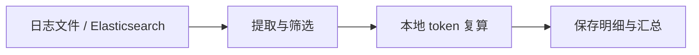

<p align="right"><strong>中文</strong> | <a href="README.en.md">English</a> | <a href="README.ja.md">日本語</a></p>

<h1 align="center">modulo</h1>
<p align="center"><strong>复算 AI 网关的 token 用量，让差异有据可查。</strong></p>
<p align="center">Python 3.12 · 本地计算 · 原文可追溯 · <a href="LICENSE">Apache-2.0</a></p>

<p align="center">
  <a href="#features">功能</a> ·
  <a href="#log-formats">日志格式</a> ·
  <a href="#tokenizers">模型支持</a> ·
  <a href="#quick-start">快速开始</a> ·
  <a href="#results">结果示例</a> ·
  <a href="#configuration">配置</a> ·
  <a href="#prometheus">Prometheus / Grafana</a> ·
  <a href="#faq">常见问题</a>
</p>

modulo 是一个基于已有日志的 **AI token 用量复核工具**，面向聚合 AI 网关的管理与运维团队、MaaS 服务运营人员和审计人员。导入日志，选择供应商和模型，即可查看来源用量、本地复算结果及差额，并追溯到每条原始记录。



<a id="features"></a>

## 功能

- **核对用量**：按供应商和模型分别汇总输入、输出 token 差额；输出包含回答、思考、工具调用和模板控制标记。
- **映射内部模型名称**：多个别名共用同一 tokenizer 参照；同名模型可以按供应商分别配置。
- **看清数据缺口**：区分一致、有差异和不可核验，保留未能复算的具体原因。
- **回查计算依据**：保存原文位置、字段转换、tokenizer／模板版本和计算参数，支持结果包内容校验。
- **导出统计**：把已有结果的调用数、覆盖率与差额直接写入 Prometheus，提供可导入的 Grafana 模板。

<a id="log-formats"></a>

## 支持的日志格式

文件和 Elasticsearch 使用同一条处理流程。按日志实际格式选择 `adapter`：

| 日志来源与官方资料 | `adapter` | 接受的记录 | modulo 样例 |
| --- | --- | --- | --- |
| [Dify](https://docs.dify.ai/en/home) | `dify` | LLM 节点执行记录、Agent thought 导出及已声明的逐轮事件格式 | [样例](examples/dify/README.md) |
| [LangChain](https://docs.langchain.com/oss/python/langchain/overview) | `langchain` | Run 对象，包括嵌套 `child_runs` 和多组输入 | [样例](examples/langchain/README.md) |
| [New API](https://docs.newapi.pro/en) | `newapi` | 消费行、已支持的 DEBUG 请求／响应与 OpenAI 兼容 SSE 日志 | [样例](examples/newapi/README.md) |
| [One API](https://github.com/songquanpeng/one-api) | `oneapi` | 消费行、已支持的请求／响应文本及配对记录 | [样例](examples/oneapi/README.md) |
| [LiteLLM 日志规范](https://docs.litellm.ai/docs/proxy/logging_spec) | `litellm` | `StandardLoggingPayload`、`LiteLLM_SpendLogs` 与已保存的流片段 | [样例](examples/litellm/README.md) |

结构化文件使用 **JSONL，一行一个记录**，JSON 数组需先展开。New API／One API 还接受已支持的 DEBUG 文本；消费表通常只有 usage，缺正文时记录对应缺口。消费行需要稳定的原始行 ID；请求／响应日志需要明确的关联 ID。

日志对象包在 `payload` 等字段中时，设置 `payload-field: payload`。ES 中的流式事件需要明确顺序，例如 `event.sequence`；不能用 ES 返回顺序猜测流片段顺序。支持范围由实际字段与格式决定，不表示这些系统默认日志都包含完整请求和响应。

New API、One API、LiteLLM 日志中的 Chat Completions、[Responses](https://developers.openai.com/api/docs/guides/migrate-to-responses) 和 [Anthropic Messages](https://platform.claude.com/docs/en/api/messages/create) 正文均可解析，包括文本、思考、函数工具调用／结果和图片输入。这三个适配器均支持日志中已有的流片段组装。[可运行样例](examples/newapi/README.md#api-正文)。

Dify thought 导出中已有的结构化 `message` 可以复算；空字段仍标缺失。LangChain 多组输入逐组保存与计数，只有 Run 总 usage 时在 `input_batches` 中比较整批，不摊到各组。LiteLLM 缓存命中仍计算正文并保留 `cache_hit`，缓存 usage 不作为本次新推理的差额依据。New API／One API 缺少正文、关联 ID、重试标识或流顺序时，报告的 `warnings` 会说明影响、缺少字段及重新导入方法。

<a id="tokenizers"></a>

## 支持的 tokenizer

已接入以下 **19 个固定型号参照**，包含日志已有的思考与工具上下文；其中十个视觉型号另支持图片输入。型号名称链接到官方模型资料；`name` 用于配置映射及准备对应 tokenizer。

<details>
<summary>展开型号、官方来源与标准名称</summary>

| 家族 | 固定型号／官方来源 | `name` |
| --- | --- | --- |
| Qwen | [Qwen3.8-2.4T-A95B](https://huggingface.co/Qwen/Qwen3.8-2.4T-A95B) | `qwen-3.8-2.4t` |
| Qwen | [Qwen3.5-122B-A10B](https://huggingface.co/Qwen/Qwen3.5-122B-A10B) | `qwen3.5-122b` |
| Qwen | [Qwen3.5-397B-A17B](https://huggingface.co/Qwen/Qwen3.5-397B-A17B) | `qwen3.5-397b` |
| DeepSeek | [DeepSeek-V4.1-Flash](https://huggingface.co/deepseek-ai/DeepSeek-V4.1-Flash) | `deepseek-v4.1` |
| DeepSeek | [DeepSeek-V4-Pro-0813](https://huggingface.co/deepseek-ai/DeepSeek-V4-Pro-0813) | `deepseek-v4-pro-0813` |
| Moonshot / Kimi | [Kimi-K3](https://huggingface.co/moonshotai/Kimi-K3) | `kimi-k3` |
| Moonshot / Kimi | [Kimi-K2.6](https://huggingface.co/moonshotai/Kimi-K2.6) | `kimi-k2.6` |
| Moonshot / Kimi | [Kimi-K2.7-Code](https://huggingface.co/moonshotai/Kimi-K2.7-Code) | `kimi-k2.7-code` |
| MiniMax | [MiniMax-M3](https://huggingface.co/MiniMaxAI/MiniMax-M3) | `minimax-m3` |
| MiniMax | [MiniMax-M2.7](https://huggingface.co/MiniMaxAI/MiniMax-M2.7) | `minimax-m2.7` |
| LongCat | [LongCat-2.0](https://huggingface.co/meituan-longcat/LongCat-2.0) | `longcat-2.0` |
| GLM | [GLM-5.3](https://huggingface.co/zai-org/GLM-5.3) | `glm-5.3` |
| GLM | [GLM-5.3-Flash](https://huggingface.co/zai-org/GLM-5.3-Flash) | `glm-5.3-flash` |
| GLM | [GLM-5.2](https://huggingface.co/zai-org/GLM-5.2) | `glm-5.2` |
| 小米 MiMo | [MiMo-V2.6-Pro-RL](https://huggingface.co/XiaomiMiMo/MiMo-V2.6-Pro-RL) | `mimo-v2.6` |
| 阶跃 Step | [Step-3.7-Flash](https://huggingface.co/stepfun-ai/Step-3.7-Flash) | `step-3.7` |
| 腾讯混元 | [Hy4-preview](https://huggingface.co/tencent/Hy4-preview) | `hy4-preview` |
| 蚂蚁 Ling | [Ling-3.0-flash](https://huggingface.co/inclusionAI/Ling-3.0-flash) | `ling-3.0` |
| 蚂蚁 Ring | [Ring-2.6-1T](https://huggingface.co/inclusionAI/Ring-2.6-1T) | `ring-2.6` |

</details>

每个参照固定词表、模板和参数，提交与文件摘要保存在 [tokenizer 资源清单](static/tokenizer-assets.json)。新增内部别名时应选择适用的参照；同家族其他型号和云 API 别名不会自动视为兼容。模板如何影响输入计数，可参考 [Hugging Face 聊天模板说明](https://huggingface.co/docs/transformers/chat_templating)。

运行清单保留下载、校验和计算所需字段；[图片处理规则的来源](static/image-processing-sources.json)与[官方许可材料](licenses/README.md)单独保留，供审阅查证。

<a id="quick-start"></a>

## 快速开始

需要 [Python 3.12](https://docs.python.org/3.12/) 和 [uv](https://docs.astral.sh/uv/getting-started/installation/)。以下 Bash 命令从仓库根目录运行：

```bash
uv sync --locked
uv run modulo prepare-assets --config config/modulo.yaml --only qwen-3.8-2.4t deepseek-v4.1
uv run modulo import --config config/modulo.yaml
```

首次准备下载词表、模板等 tokenizer 文件，不下载模型权重。复算在本地完成，无需 GPU 或调用模型服务。准备其他型号时，将 `--only` 后的名称替换为上表的 `name`；省略 `--only` 则准备全部。

下载源默认 `global`（Hugging Face）。国内网络可将 [modulo.yaml](config/modulo.yaml) 中的 `asset-source` 改为 `cn`（[魔搭 ModelScope](https://modelscope.cn/models)），也可在 `prepare-assets` 后加 `--asset-source cn` 临时覆盖。目前 19 个型号均已固定魔搭仓库与提交，两种来源使用同一组文件 SHA-256 校验；已有文件可复用，`cn` 下载失败不会自动切回国外源。

默认配置读取自带的 Dify 合成样例，得到 **8 条调用，输入结论为：2 条一致、1 条有差异、5 条不可核验**。样例特意包含差额和缺字段场景。

导入后会打印结果目录，将下面的 `RUN_DIR` 替换为该路径：

```bash
uv run modulo report RUN_DIR            # 汇总
uv run modulo report RUN_DIR --details  # 逐条明细
uv run modulo verify RUN_DIR            # 结果包内容校验
```

<a id="results"></a>

## 结果示例

以下是 [Dify 样例](examples/dify/basic.jsonl) 部分实际结果的表格展示。差额为 **日志报告值 − 本地参照值**：

| 日志中的模型名 | 报告输入 token | 本地输入 token | 差额 | 输入结论 |
| --- | ---: | ---: | ---: | --- |
| Qwen/Qwen3.8-2.4T-A95B | 66 | 66 | 0 | 一致 `CONSISTENT` |
| deepseek-ai/DeepSeek-V4.1-Flash | 58 | 55 | +3 | 有差异 `DEVIATION` |
| Qwen/Qwen3.8-2.4T-A95B | 未记录 | 59 | — | 不可核验 `UNVERIFIABLE` |

上表是固定 tokenizer／模板下的**输入参照比较**。输出另有 `output_tokens`、`output_delta`、`output_verdict`，计入回答、思考、工具调用及结束标记，并扣除已在输入中的生成前缀。差额均为报告值减本地参照值，输入与输出独立判定。

结果同时提供三组结论，汇总统计各状态的条数：

| 汇总字段 | 明细字段 | 含义 |
| --- | --- | --- |
| `verdicts` | `verdict` | 整次调用 |
| `input_verdicts` | `input_verdict` | 输入比较 |
| `output_verdicts` | `output_verdict` | 输出比较 |

**整体规则：任一侧有差异 → 有差异；两侧都一致 → 一致；其余 → 不可核验。** 输入和输出的正负差额不能相互抵消成“一致”。

[输出样例](examples/litellm/output-audit.jsonl) 的同一段回答、思考与工具调用，本地完整参照为 **45 token**：报告 45 判一致，48 的差额为 +3，42 为 −3。其余三条演示缺 usage、缺结束原因和截断，均不判一致。可用下列命令查看明细：

```bash
uv run modulo import --source log --adapter litellm \
  --path examples/litellm/output-audit.jsonl \
  --bindings examples/litellm/basic.bindings.yaml
```

结论是本地固定参照比较，不证明服务端实际生成的 token ID 或模型身份。正文分项不能直接相加替代总数。汇总保留可比较条数，缺失不填零；基础输入样例的预期见 [样例登记](tests/fixtures/expected/basic.json)。

每次导入保存原始记录及位置、调用明细、差额、缺失诊断和计算依据。JSON／JSONL 保留复核材料，DuckDB 提供可重建的本地查询。`verify` 校验内容摘要；新配置或规则产生新结果，旧结果保留。

<a id="configuration"></a>

## 接入自己的日志

主要配置三件事：**日志在哪里、内部模型名对应哪个 tokenizer、扫描哪些供应商**。修改 [主配置](config/modulo.yaml)，再选择 [文件来源](config/import-log-file.yaml) 或 [ES 来源](config/import-es.yaml)。来源文件只保存读取设置。

<details open>
<summary>主配置：日志格式、模型别名与供应商</summary>

`config/modulo.yaml` 示意；下面只展示两项模型映射，仓库文件已列齐 19 个型号：

```yaml
source: log
source-config: import-log-file.yaml
adapter: dify

# 按需启用供应商筛选
# platform-tag-source: field:platform
# platforms: [volcengine, huaweicloud]

models:
  - name: qwen-3.8-2.4t
    aliases: [Qwen/Qwen3.8-2.4T-A95B, qwen-2.4t]
  - name: deepseek-v4.1
    aliases: [deepseek-ai/DeepSeek-V4.1-Flash, volc-deepseek]

assets: ../assets/tokenizers
output: ../runs
```

`name` 选择标准型号；日志里的官方名称和内部别名都填写在对应 `aliases` 数组中，按原文精确匹配。`models` 是映射表；临时只扫描某些模型用 CLI `--models`。映射之外的型号仍可导入，但缺少参照时不可复算。

`platform-tag-source` 支持 `field:<路径>`、`metadata:<路径>`、`endpoint`、`literal:<供应商名>` 和 `none`。不筛选供应商就省略 `platforms`；整批属于同一供应商可以用 `literal:volcengine`。endpoint 模式需通过 `endpoint-source` 和 `endpoint-map` 明确取值与映射，可参考 [配套配置样例](examples/dify/platforms-endpoint.yaml)。

某个模型映射只适用于一家供应商时，在该条目内增加 `platform`，也可同时写 `platform-tag-source`。命中的平台条目优先，否则使用不带 `platform` 的全局条目；冲突报错。平台和模型名称都精确匹配，`*` 不表示全部。

</details>

<a id="file-source"></a>

<details>
<summary>文件来源：单文件或按日期匹配目录</summary>

`config/import-log-file.yaml`：

```yaml
path: /data/logs/dify
pattern: dify-access-log-202610*.jsonl
```

读取单个文件时，`path` 填文件路径并删除 `pattern`。目录读取必须填写 pattern，支持 `*`、`?`、`[]` 和 `**/`。一次导入使用同一个 adapter；不同格式分批运行。

</details>

<a id="es-source"></a>

<details>
<summary>Elasticsearch：索引模式与认证</summary>

主配置改为 `source: es`、`source-config: import-es.yaml`。`config/import-es.yaml`：

```yaml
path: https://es.example.com:9200
index: dify-access-log-202610*
username: audit-reader
password-env: MODULO_ES_PASSWORD
```

通过环境变量提供密码，再运行导入：

```bash
read -rsp 'ES password: ' MODULO_ES_PASSWORD
export MODULO_ES_PASSWORD
uv run modulo import --config config/modulo.yaml
```

使用 API key 时，删除 `username`／`password-env`，改为 `api-key-env: MODULO_ES_API_KEY` 并设置相应环境变量。两种认证二选一；变量未设置或为空会报错。未配置认证字段时不认证，适用于本地实验。

需要 ES 原生查询时，可添加 `query-file: query.json`，文件内容为查询子句，例如 `{"range":{"@timestamp":{"gte":"2026-10-01","lt":"2026-10-04"}}}`。读取使用 [PIT 与 search_after 分页](https://www.elastic.co/docs/reference/elasticsearch/rest-apis/paginate-search-results)，不修改源索引。

</details>

配置内相对路径以声明它的 YAML 所在目录为准；命令行路径以当前工作目录为准。显式 CLI 参数覆盖对应配置，例如：

```bash
uv run modulo import --config config/modulo.yaml \
  --models "deepseek-ai/DeepSeek-V4.1-Flash" "volc-deepseek"
uv run modulo import --help
```

大批量导入默认不限条数，中间记录、去重和待关联片段落入本地磁盘工作区，逐条计算与写出。`--memory-mib 64` 设置工作缓存预算；tokenizer、单条调用和 JSON 解码的内存另计，不是进程总内存上限。`--max-record-mib` 默认 8；`--max-records N` 可限制一次新增读取量，0 表示不限。

需要续读或让分批到达的请求／响应继续关联时，指定状态目录；持续读取再加 `--follow`：

```bash
uv run modulo import --config config/modulo.yaml --state runs/import-state
uv run modulo import --config config/modulo.yaml --state runs/import-state \
  --follow --poll-seconds 30
```

同一状态目录生成累计结果快照，旧快照保留，未变化调用复用已有计算。Ctrl+C 停止后可用同一命令继续；未提交的读取会重读并去重。文件追加及重命名轮转可续读，半行等到换行后再处理，已读前缀被改写／截短会报错。ES 快照有效时从游标继续，过期或开始新一轮扫描时重新分页并按来源记录去重，因此会重新读取旧文档。状态和历史快照占用磁盘，按审计周期使用独立目录；计算规则或程序变更时使用新状态目录。读取不完整和数据缺口继续反映在报告中。更多输入见 [协议样例](examples/README.md)。

<a id="sampling"></a>

## 采样与买方数据范围

默认全量。可在主配置的 `sampling` 中选择：

| mode | 行为 | 必填参数 |
| --- | --- | --- |
| `all` | 复算全部符合筛选条件的调用 | 无 |
| `ratio` | 各平台／模型按固定概率抽样，实际数量会波动 | `ratio: 0.1` |
| `count` | 每个平台／模型随机抽取最多 N 个单位 | `count: 100` |
| `window` | 从一个已结束的时间窗口随机抽取最多 N 个单位 | `window-minutes: 5`、`count: 100` |

```yaml
sampling:
  mode: window
  window-minutes: 5
  count: 100
  seed: buyer-local-seed
```

时间模式按规范化调用的 `started_at`，默认选择最近已结束的 UTC 窗口，包含起点、不包含终点。例如 10:07 执行，5 分钟窗口取 10:00–10:05。历史窗口可用 `--sample-before '2026-10-13T10:05:00+08:00'` 重跑；缺失、无时区或冲突的时间不猜补，留在本地诊断。

先关联请求、响应和流片段，再抽样。普通调用是一个单位；共享总 usage 的 LangChain Run 整组作为一个单位，因此实际调用数可能超过额度。`seed` 与日志相同，抽样结果可复现，不受读取顺序影响。`max-records` 仍是读取上限，不是随机抽样；采样节省复算量，仍需读取并关联所选来源的日志。

命令行可覆盖配置，切换模式不会继承上一模式的比例／额度／窗口参数：

```bash
uv run modulo import --config config/modulo.yaml --sample-mode ratio --sample-ratio 0.1
uv run modulo import --config config/modulo.yaml --sample-mode count --sample-count 100
```

定时触发使用系统 [cron](https://man7.org/linux/man-pages/man5/crontab.5.html)，程序每次运行后退出。例如每 5 分钟处理一个窗口（把 `/opt/modulo` 换成安装路径，先在配置中启用 window 模式）：

```cron
*/5 * * * * /opt/modulo/.venv/bin/modulo import --config /opt/modulo/config/modulo.yaml --state /opt/modulo/state >> /opt/modulo/sampling.log 2>&1
```

cron 的触发频率与采样窗口长度分别设置。默认只处理最近一个已结束窗口，不自动补跑停机期间的窗口；晚到日志可用 `--sample-before` 重跑。上述命令只处理已有日志，不自动上传结果，也不安装定时任务。

向外部 Prometheus 导出时，在导出配置设置 `visibility: sample-only`：只提供满额的 `count`／`window` 样本统计，不发送原始记录数、候选总数、实际抽样比例、种子或总体覆盖率。`auto` 默认对 window 使用此规则，其他模式完整导出；`full` 用于获准查看总体规模的买方内部监控。比例抽样和全量结果不能使用 sample-only。

不足额度、读取未完成、非法记录或调用时间不明时，受限导出返回 `export: withheld`，不发送请求；退出码 0 表示按策略完成，不表示已发送。接收方仍保留之前的快照，应查看结果时间。切换策略不会删除已发送的历史数据；对外使用独立的 scope／接收方。

本地结果包、命令输出与上述 cron 日志仍包含完整规模及原文依据，不能作为受限导出交给外部。样本内覆盖率以抽中调用为分母；总体覆盖率以本次采样范围的候选调用为分母，只在本地或 full 导出中提供。候选数与抽样数都保存，缺少有效时间的调用单列，不伪造分母。

<a id="prometheus"></a>

## Prometheus 与 Grafana

Prometheus 启动时加上 `--web.enable-remote-write-receiver`，然后导出已有结果包：

```bash
uv run modulo export-prometheus runs/<结果目录> \
  --url http://localhost:9090/api/v1/write --scope my-gateway

# 也可将地址、scope 和认证配置保存在 YAML 中
uv run modulo export-prometheus runs/<结果目录> \
  --config config/export-prometheus.yaml
```

[导出配置](config/export-prometheus.yaml) 支持 Basic／Bearer 认证（凭证从指定环境变量读取）、自定义 CA、超时和序列数量上限，显式 CLI 参数优先。命令校验结果包、读取已保存的计算结果，发送后退出；不重新运行 tokenizer，不需要 Pushgateway 或常驻服务。Prometheus 的 [Remote Write 接收接口](https://prometheus.io/docs/prometheus/latest/querying/api/#remote-write-receiver) 需要由用户开启。

在 Grafana 中[导入](https://grafana.com/docs/grafana/latest/visualizations/dashboards/build-dashboards/import-dashboards/) [static/grafana/modulo.json](static/grafana/modulo.json)，选择自己的 Prometheus 数据源，即可按 scope、供应商和模型查看调用数、整体／输入／输出结论、复算覆盖率、比较覆盖率与 token 差额。分母为零显示无数据；token 差额只汇总同一可比较调用集合。LangChain Run 总 usage 另列组级结果。

`scope` 是稳定的统计范围名称。同一 scope 展示最近导出的结果快照，重复导出不累加调用数；独立网关或不同审计范围使用不同 scope。全部指标是 Gauge，不能对它们使用 `rate()`／`increase()` 来计算调用量。模板排除旧快照已消失的模型分组；原结果时间单独显示，重发旧结果不会更新它。快照采样时间是**导出时间**，不按日志发生时间回填历史曲线。

模板默认查看最近 7 天内的最后一次导出，可调整右上角时间范围；超过该范围或 Prometheus 保留期会显示无数据。明细与精确整数仍保存在本地结果包。网络错误、429、5xx 最多尝试 3 次；其他失败立即返回非零退出码，不声称写入成功。单次默认最多 10,000 条指标序列，可用 `--max-series` 调整。Prometheus／Grafana 的部署和维护由用户负责。

<a id="faq"></a>

## 常见问题

<details>
<summary>为什么有些调用显示“不可核验”？</summary>

可能缺请求正文、缺来源 usage、模型没有绑定，或记录包含当前不能复算的内容。明细保留原因和已有计数。输入与输出独立处理；输出正文可得时，不因输入缺失丢掉它的计数。

</details>

<details>
<summary>工具调用和思考内容能复算吗？</summary>

19 个固定型号均支持输入工具上下文和完整输出参照复算，包括思考正文、并行工具调用、控制与结束标记。正常结束按模板计入结束标记；`length`／`max_tokens` 达到上限时按已生成正文计算，不补 EOS。自定义停止词或 token ID 有实际命中记录时计一次；缺少命中依据时保留具体原因。有报告 usage 才产生输出差额和结论。真实日志截断、缺字段、音视频或未知参数仍保留缺口，`partial` 不表示完整核验。

支持 `response_format`／JSON Schema、`tool_choice`（含指定函数）、`parallel_tool_calls` 和生成前缀参数。约束交给选定模板，不凭空增加提示词。Responses 的多条 assistant 消息保留边界；交错正文可通过绑定中的 `chat-template`／`template-kwargs` 指定参照，模板由配置提供。见 [参数与模板配置](examples/litellm/README.md#请求参数与自定义模板)。

支持日志中 `thinking`／`reasoning` 等结构化正文块，保留原始块与来源；签名不计入正文，摘要或脱敏内容不冒充完整思考。LangChain、LiteLLM、New API、One API 的多候选回答按候选分别复算，再与一次请求的总 usage 比较，不重复累计。见 [可运行样例](examples/litellm/README.md#结构化正文与多候选)。

</details>

<details>
<summary>图片输入能复算吗？</summary>

支持 Qwen3.5-122B-A10B／397B-A17B、DeepSeek-V4.1-Flash、Kimi-K3／K2.6／K2.7-Code、GLM-5.3-Flash、MiniMax-M3、MiMo-V2.6-Pro-RL、Step-3.7-Flash 的固定图片参照，计入视觉位置、图片边界和切图标记，再与文字组成完整输入；无需模型权重或 GPU。

日志需保留图片在正文中的顺序，以及内嵌图片或可信宽高；Qwen3.5／GLM-5.3-Flash／MiniMax-M3／MiMo 也可使用逐图记录的 `image_grid_thw`。缺省处理参数明确标为固定参照默认值。五种日志适配器共用该能力，见 [图片样例与结果](examples/litellm/README.md#图片输入)。

只有 URL、缺少尺寸时，可在主配置中开启下载。**默认关闭**；启用后下载公网 HTTP(S) 图片，读取尺寸并复算：

```yaml
image-download:
  enabled: true
  cache-dir: /tmp/modulo-images  # 可省略，默认使用系统临时目录下的专用目录
  max-file-bytes: 10485760      # 单图 10 MiB
  max-cache-bytes: 268435456    # 缓存总量 256 MiB
  ttl-seconds: 86400           # 保留 24 小时
```

`--download-images`／`--no-download-images` 可临时覆盖开关。启用下载的导入在开始、结束和缓存写入后清理过期与超额文件；没有后台常驻进程，缓存不作为永久归档。相对缓存路径以主配置所在目录为准。

下载时间、SHA-256、字节数和来源进入明细。失效链接、超限、图片截断、顺序丢失及未支持的裁剪／`detail` 参数会保留缺口，输出复算仍独立进行。不会读取日志中的本地文件路径，也不继承系统代理／登录凭证。

内网地址默认拒绝。若使用内网图片库或 DNS 的 Fake-IP 映射，可在 `image-download` 下添加 `allow-private-hosts: [images.example.com]`，仅放行明确可信的完整域名；不支持 `*`，重定向后的域名也逐一检查。

</details>

<details>
<summary>如何试用本地 Elasticsearch 和 Kibana？</summary>

需要 Docker Engine 与 Compose，无需 Kubernetes。在仓库根目录运行：

```bash
docker compose -f tests/local-dev/compose.yaml up -d --wait --wait-timeout 300
uv run python tests/local-dev/elastic_lab.py seed
uv run modulo import --source es --path http://localhost:9200 \
  --index 'dify-access-log-2026100*' --adapter dify --payload-field payload
```

打开 [Kibana Discover](http://localhost:5601/s/modulo/app/discover)，时间范围选择 2026-10-01 至 2026-10-04（Asia/Shanghai）。六个日索引共 24 条合成日志，分别属于 Dify 和 LangChain；Kibana 查看源日志，复算结果通过 modulo 查看。

实验服务仅绑定本机、无认证；配置见 [Compose](tests/local-dev/compose.yaml)。国内镜像覆盖文件见 [compose.mirror.yaml](tests/local-dev/compose.mirror.yaml)，启动时在主文件后追加相应 `-f` 参数。停止容器可运行 `docker compose -f tests/local-dev/compose.yaml stop`。

</details>

欢迎反馈日志解析问题、补充可复现样例或改进说明。请提供运行命令、预期结果和去除敏感信息的最小样例。

## 许可证

modulo 采用 [Apache License 2.0](LICENSE)。第三方依赖、tokenizer 和模板资产遵循各自的许可证；已保留的上游许可见 [licenses/](licenses/README.md)。
