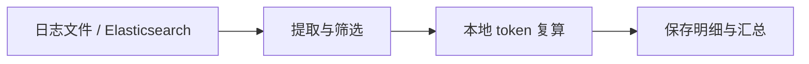

<p align="right"><strong>中文</strong> | <a href="README.en.md">English</a> | <a href="README.ja.md">日本語</a></p>

<h1 align="center">modulo</h1>
<p align="center"><strong>复算 AI 网关的 token 用量，让差异有据可查。</strong></p>
<p align="center">Python 3.12 · 本地计算 · 原文可追溯 · <a href="LICENSE">Apache-2.0</a></p>

<p align="center">
  <a href="#features">功能</a> ·
  <a href="#log-formats">日志格式</a> ·
  <a href="#tokenizers">模型支持</a> ·
  <a href="#quick-start">快速开始</a> ·
  <a href="#results">结果示例</a> ·
  <a href="#configuration">配置</a> ·
  <a href="#faq">常见问题</a>
</p>

modulo 是一个基于已有日志的 **AI token 用量复核工具**，面向聚合 AI 网关的管理与运维团队、MaaS 服务运营人员和审计人员。导入日志，选择供应商和模型，即可查看来源用量、本地复算结果及差额，并追溯到每条原始记录。



<a id="features"></a>

## 功能

- **核对用量**：按供应商和模型汇总输入 token 差额，单独查看回答与思考正文的本地计数。
- **映射内部模型名称**：多个别名共用同一 tokenizer 参照；同名模型可以按供应商分别配置。
- **看清数据缺口**：区分一致、有差异和不可核验，保留未能复算的具体原因。
- **回查计算依据**：保存原文位置、字段转换、tokenizer／模板版本和计算参数，支持结果包内容校验。

<a id="log-formats"></a>

## 支持的日志格式

文件和 Elasticsearch 使用同一条处理流程。按日志实际格式选择 `adapter`：

| 日志来源与官方资料 | `adapter` | 接受的记录 | modulo 样例 |
| --- | --- | --- | --- |
| [Dify](https://docs.dify.ai/en/home) | `dify` | LLM 节点执行记录、Agent thought 导出及已声明的逐轮事件格式 | [样例](examples/dify/README.md) |
| [LangChain](https://docs.langchain.com/oss/python/langchain/overview) | `langchain` | Run 对象，包括嵌套 `child_runs` | [样例](examples/langchain/README.md) |
| [New API](https://docs.newapi.pro/en) | `newapi` | 消费行、已支持的 DEBUG 请求／响应与 OpenAI 兼容 SSE 日志 | [样例](examples/newapi/README.md) |
| [One API](https://github.com/songquanpeng/one-api) | `oneapi` | 消费行、已支持的请求／响应文本及配对记录 | [样例](examples/oneapi/README.md) |
| [LiteLLM 日志规范](https://docs.litellm.ai/docs/proxy/logging_spec) | `litellm` | 终态 `StandardLoggingPayload` 或单条 `LiteLLM_SpendLogs` 导出 | [样例](examples/litellm/README.md) |

结构化文件使用 **JSONL，一行一个记录**，JSON 数组需先展开。New API／One API 还接受已支持的 DEBUG 文本；消费表通常只有 usage，缺正文时记录对应缺口。消费行需要稳定的原始行 ID；请求／响应日志需要明确的关联 ID。

日志对象包在 `payload` 等字段中时，设置 `payload-field: payload`。ES 中的流式事件需要明确顺序，例如 `event.sequence`；不能用 ES 返回顺序猜测流片段顺序。支持范围由实际字段与格式决定，不表示这些系统默认日志都包含完整请求和响应。

<a id="tokenizers"></a>

## 支持的 tokenizer

已接入以下 **11 个固定型号的文本参照**，包含日志已有的思考与工具上下文。型号名称链接到官方模型资料；`asset` 用于配置映射及准备对应 tokenizer。

<details>
<summary>展开型号、官方来源与 asset 名称</summary>

| 家族 | 固定型号／官方来源 | `asset` |
| --- | --- | --- |
| Qwen | [Qwen3.8-2.4T-A95B](https://huggingface.co/Qwen/Qwen3.8-2.4T-A95B) | `qwen3.8` |
| DeepSeek | [DeepSeek-V4.1-Flash](https://huggingface.co/deepseek-ai/DeepSeek-V4.1-Flash) | `deepseek-v4.1` |
| Moonshot / Kimi | [Kimi-K3](https://huggingface.co/moonshotai/Kimi-K3) | `kimi-k3` |
| MiniMax | [MiniMax-M3](https://huggingface.co/MiniMaxAI/MiniMax-M3) | `minimax-m3` |
| LongCat | [LongCat-2.0](https://huggingface.co/meituan-longcat/LongCat-2.0) | `longcat-2.0` |
| GLM | [GLM-5.3](https://huggingface.co/zai-org/GLM-5.3) | `glm-5.3` |
| 小米 MiMo | [MiMo-V2.6-Pro-RL](https://huggingface.co/XiaomiMiMo/MiMo-V2.6-Pro-RL) | `mimo-v2.6` |
| 阶跃 Step | [Step-3.7-Flash](https://huggingface.co/stepfun-ai/Step-3.7-Flash) | `step-3.7` |
| 腾讯混元 | [Hy4-preview](https://huggingface.co/tencent/Hy4-preview) | `hy4-preview` |
| 蚂蚁 Ling | [Ling-3.0-flash](https://huggingface.co/inclusionAI/Ling-3.0-flash) | `ling-3.0` |
| 蚂蚁 Ring | [Ring-2.6-1T](https://huggingface.co/inclusionAI/Ring-2.6-1T) | `ring-2.6` |

</details>

每个参照固定词表、模板和参数，提交与文件摘要保存在 [资产清单](src/modulo/application/assets-lock.json)。新增内部别名时应选择适用的参照；同家族其他型号和云 API 别名不会自动视为兼容。模板如何影响输入计数，可参考 [Hugging Face 聊天模板说明](https://huggingface.co/docs/transformers/chat_templating)。

<a id="quick-start"></a>

## 快速开始

需要 [Python 3.12](https://docs.python.org/3.12/) 和 [uv](https://docs.astral.sh/uv/getting-started/installation/)。以下 Bash 命令从仓库根目录运行：

```bash
uv sync --locked
uv run modulo prepare-assets --only qwen3.8 deepseek-v4.1
uv run modulo import --config config/modulo.yaml
```

首次准备下载词表、模板等 tokenizer 文件，不下载模型权重。复算在本地完成，无需 GPU 或调用模型服务。准备其他型号时，将 `--only` 后的名称替换为上表的 asset；省略 `--only` 则准备全部。

默认配置读取自带的 Dify 合成样例，得到 **8 条调用：2 条一致、1 条有差异、5 条不可核验**。样例特意包含差额和缺字段场景。

导入后会打印结果目录，将下面的 `RUN_DIR` 替换为该路径：

```bash
uv run modulo report RUN_DIR            # 汇总
uv run modulo report RUN_DIR --details  # 逐条明细
uv run modulo verify RUN_DIR            # 结果包内容校验
```

<a id="results"></a>

## 结果示例

以下是 [Dify 样例](examples/dify/basic.jsonl) 部分实际结果的表格展示。差额为 **日志报告值 − 本地参照值**：

| 日志中的模型名 | 报告输入 token | 本地输入 token | 差额 | 结论 |
| --- | ---: | ---: | ---: | --- |
| Qwen/Qwen3.8-2.4T-A95B | 66 | 66 | 0 | 一致 `CONSISTENT` |
| deepseek-ai/DeepSeek-V4.1-Flash | 58 | 55 | +3 | 有差异 `DEVIATION` |
| Qwen/Qwen3.8-2.4T-A95B | 未记录 | 59 | — | 不可核验 `UNVERIFIABLE` |

结论针对固定 tokenizer／模板下的**输入参照比较**。回答与思考正文另列分项重编码计数，不等于完整的服务端输出 token 计量；一致也不证明供应商实际部署的模型身份。汇总差额只覆盖可比较的调用，缺失值不填零。样例预期见 [样例登记](tests/fixtures/expected/basic.json)。

每次导入保存原始记录及位置、调用明细、差额、缺失诊断和计算依据。JSON／JSONL 保留复核材料，DuckDB 提供可重建的本地查询。`verify` 校验内容摘要；新配置或规则产生新结果，旧结果保留。

<a id="configuration"></a>

## 接入自己的日志

主要配置三件事：**日志在哪里、内部模型名对应哪个 tokenizer、扫描哪些供应商**。修改 [主配置](config/modulo.yaml)，再选择 [文件来源](config/import-log-file.yaml) 或 [ES 来源](config/import-es.yaml)。来源文件只保存读取设置。

<details open>
<summary>主配置：日志格式、模型别名与供应商</summary>

`config/modulo.yaml` 示意；下面只展示两项模型映射，仓库文件已列齐 11 个型号：

```yaml
source: log
source-config: import-log-file.yaml
adapter: dify

# 按需启用供应商筛选
# platform-tag-source: field:platform
# platforms: [volcengine, huaweicloud]

models:
  - modelnames: [Qwen/Qwen3.8-2.4T-A95B, qwen-2.4t]
    asset: qwen3.8
  - modelnames: [deepseek-ai/DeepSeek-V4.1-Flash, volc-deepseek]
    asset: deepseek-v4.1

assets: ../assets/tokenizers
output: ../runs
```

内部别名直接追加到对应 `modelnames` 数组。`models` 是映射表；临时只扫描某些模型用 CLI `--models`。映射之外的型号仍可导入，但缺少参照时不可复算。

`platform-tag-source` 支持 `field:<路径>`、`metadata:<路径>`、`endpoint`、`literal:<供应商名>` 和 `none`。不筛选供应商就省略 `platforms`；整批属于同一供应商可以用 `literal:volcengine`。endpoint 模式需通过 `endpoint-source` 和 `endpoint-map` 明确取值与映射，可参考 [配套配置样例](examples/dify/platforms-endpoint.yaml)。

某个模型映射只适用于一家供应商时，在该条目内增加 `platform`，也可同时写 `platform-tag-source`。命中的平台条目优先，否则使用不带 `platform` 的全局条目；冲突报错。平台和模型名称都精确匹配，`*` 不表示全部。

</details>

<a id="file-source"></a>

<details>
<summary>文件来源：单文件或按日期匹配目录</summary>

`config/import-log-file.yaml`：

```yaml
path: /data/logs/dify
pattern: dify-access-log-202610*.jsonl
```

读取单个文件时，`path` 填文件路径并删除 `pattern`。目录读取必须填写 pattern，支持 `*`、`?`、`[]` 和 `**/`。一次导入使用同一个 adapter；不同格式分批运行。

</details>

<a id="es-source"></a>

<details>
<summary>Elasticsearch：索引模式与认证</summary>

主配置改为 `source: es`、`source-config: import-es.yaml`。`config/import-es.yaml`：

```yaml
path: https://es.example.com:9200
index: dify-access-log-202610*
username: audit-reader
password-env: MODULO_ES_PASSWORD
```

通过环境变量提供密码，再运行导入：

```bash
read -rsp 'ES password: ' MODULO_ES_PASSWORD
export MODULO_ES_PASSWORD
uv run modulo import --config config/modulo.yaml
```

使用 API key 时，删除 `username`／`password-env`，改为 `api-key-env: MODULO_ES_API_KEY` 并设置相应环境变量。两种认证二选一；变量未设置或为空会报错。未配置认证字段时不认证，适用于本地实验。

需要 ES 原生查询时，可添加 `query-file: query.json`，文件内容为查询子句，例如 `{"range":{"@timestamp":{"gte":"2026-10-01","lt":"2026-10-04"}}}`。读取使用 [PIT 与 search_after 分页](https://www.elastic.co/docs/reference/elasticsearch/rest-apis/paginate-search-results)，不修改源索引。

</details>

配置内相对路径以声明它的 YAML 所在目录为准；命令行路径以当前工作目录为准。显式 CLI 参数覆盖对应配置，例如：

```bash
uv run modulo import --config config/modulo.yaml \
  --models "deepseek-ai/DeepSeek-V4.1-Flash" "volc-deepseek"
uv run modulo import --help
```

默认每批最多读取 10,000 条原始记录，可通过 `--max-records` 调整；截断、读取错误和数据缺口会反映在结果状态中。更多可运行输入见 [协议样例](examples/README.md)。

<a id="faq"></a>

## 常见问题

<details>
<summary>为什么有些调用显示“不可核验”？</summary>

可能缺请求正文、缺来源 usage、模型没有绑定，或记录包含当前不能复算的内容。明细保留原因和已有计数。输入与输出独立处理；输出正文可得时，不因输入缺失丢掉它的计数。

</details>

<details>
<summary>工具调用和思考内容能复算吗？</summary>

已支持上述固定型号在日志中记录的思考与工具上下文，包括输入中的工具定义、历史调用和工具返回。回答与思考正文分别重编码计数，完整工具输出的生成 token 核验尚未提供。图片、音视频、未支持的参数或不完整日志会记录对应缺口。

</details>

<details>
<summary>如何试用本地 Elasticsearch 和 Kibana？</summary>

需要 Docker Engine 与 Compose，无需 Kubernetes。在仓库根目录运行：

```bash
docker compose -f tests/local-dev/compose.yaml up -d --wait --wait-timeout 300
uv run python tests/local-dev/elastic_lab.py seed
uv run modulo import --source es --path http://localhost:9200 \
  --index 'dify-access-log-2026100*' --adapter dify --payload-field payload
```

打开 [Kibana Discover](http://localhost:5601/s/modulo/app/discover)，时间范围选择 2026-10-01 至 2026-10-04（Asia/Shanghai）。六个日索引共 24 条合成日志，分别属于 Dify 和 LangChain；Kibana 查看源日志，复算结果通过 modulo 查看。

实验服务仅绑定本机、无认证；配置见 [Compose](tests/local-dev/compose.yaml)。国内镜像覆盖文件见 [compose.mirror.yaml](tests/local-dev/compose.mirror.yaml)，启动时在主文件后追加相应 `-f` 参数。停止容器可运行 `docker compose -f tests/local-dev/compose.yaml stop`。

</details>

欢迎反馈日志解析问题、补充可复现样例或改进说明。请提供运行命令、预期结果和去除敏感信息的最小样例。

## 许可证

modulo 采用 [Apache License 2.0](LICENSE)。第三方依赖、tokenizer 和模板资产遵循各自的许可证。
